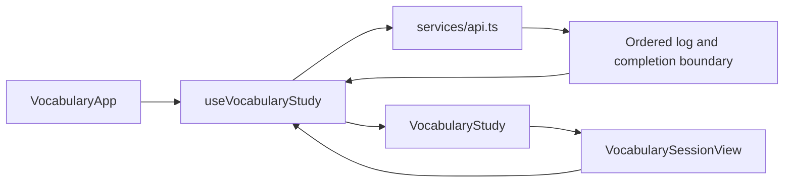

# Frontend architecture map

For contributors tracing the Mandarin frontend, this document maps component
ownership, controller wiring, and session interaction handling. The
[vocabulary contract](vocabulary-learning.md) defines product behavior; the
[implementation guide](../docs/vocabulary-learning.md) explains backend effects.

## Entry and navigation

`main.tsx` mounts the authenticated app. `App.tsx` selects `VocabularyApp` for
Mandarin and lazy-loads the retained `LegacyApp` for the French experiment.
`VocabularyApp` owns cross-page navigation, account-scoped welcome/update state,
backend settings, and the mounted study controller. `AppChrome` supplies Home,
Words, Feedback, Content Bin, and About. Study hides the ordinary navigation.

Words contains Stash (`PriorityPage` and its existing controller) and My words
(`VocabularyWordsPage`). The latter reads current modes and exposes explicit
mode, refresh, and dismissal commands. Content Bin remains a read-only browser
of retained source primitives; its link opens current Vocabulary content review.
Operator Usage's historical quality panel also points to that review workflow.

## Session ownership

`features/vocabulary-study/useVocabularyStudy.ts` owns the live request queue,
retry IDs, answer submission, completion cancellation/restaging, and current-mode
overlays. Its controller survives page navigation while the app remains mounted.
The server acknowledges durable evidence; the shared vocabulary-session reducer
projects covering, supported Undo, and session outcomes. The browser does not
persist an active-session recovery log in this delivery.

`VocabularyStudy.tsx` adapts those contracts to presentation props. It supplies
only safe word identities, so unrevealed production targets cannot leak through
headings or the earlier-word tray. Recognition presents hanzi before reveal and
pronunciation/meaning afterward. `render-material.tsx` renders retained authored
material and applies the learner's character settings.

`features/vocabulary-ui/` owns cards, summary, feedback disclosure, mode controls,
finish confirmation, and the scrolling history tray. It emits callbacks rather
than deciding scheduling or applying learner effects. The tray receives all
safe entries in recent-activity order; its scroll position can remain on older
words while new activity arrives.

Mode switches live in the summary and Words panel. Pending-summary edits cancel
and restage the immutable completion boundary. Closed-summary mode changes update
current state without rewriting historical outcomes. The summary's cancellation
window uses the backend deadline.

## Feedback and operators

`VocabularyFeedbackPage` renders private read-only lessons and retries failed
lesson generation. Its lightweight attention polling is separate from What's New
read state. `VocabularyOperatorPage` shows cases, source/encounter evidence,
versioned drafts, validated previews, explicit approval, and application receipts.
`features/vocabulary-operator/api.ts` uses the common authenticated transport in
`services/api.ts`; the server enforces operator access independently of navigation.

Connections continues through `SessionDebriefPanel` and its loader. New vocabulary
completion identities are supported by the existing background Connections queue.
The Home page uses current vocabulary statistics and existing session settings,
Connections, and What's New components.

## Verification surfaces

The [testing map](../docs/testing.md) separates the real-hook cancellation fixture,
standalone visual scenarios, operator fixture, and disposable API-backed study
fixture. Server-rendered checks do not establish focus, scrolling, or live timing.
The UI and prompt [handoffs](../docs/implementation/vocabulary-ui-handoff.md)
retain iteration context; current behavior is owned by the feature contract.
