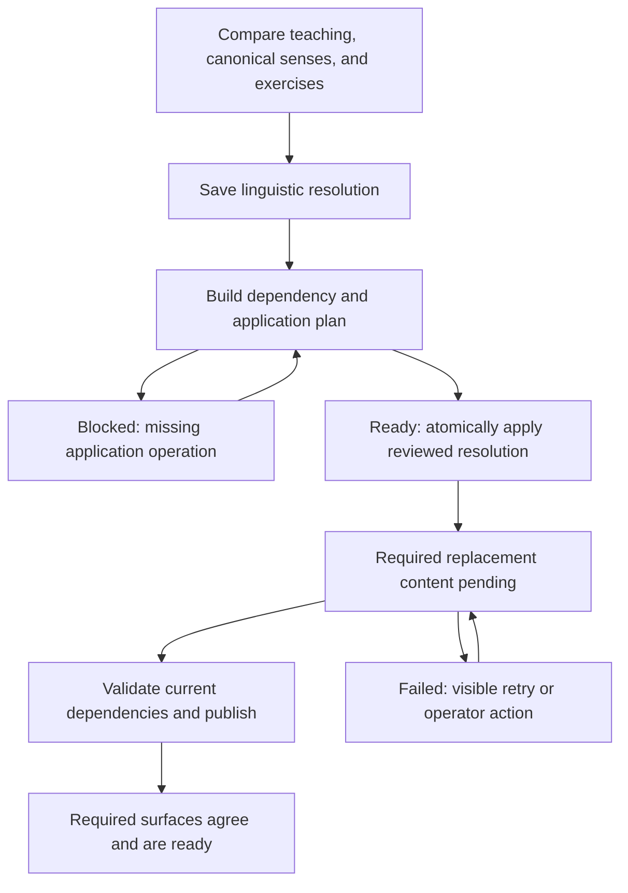

# Resolve sense and content divergence

Status: delivery specification with a bounded implementation described below;
not a production deployment or repair certificate. This document defines the first operator reconciliation flow,
using 挂钩 as its end-to-end case. It records the decisions an operator can make,
when they can take effect, and what must happen before affected content is ready.

The feature extends the [vocabulary architecture](vocabulary-architecture.md#canonical-senses-and-useful-selection)
and [content-repair authority](vocabulary-learning.md#reactions-feedback-content-repair-and-authority).
Implementation must reconcile those owning contracts with the guarantees below.
This specification authorizes neither production repairs nor corpus-wide generation.

## Deliverable and motivating case

Deliver an operator workspace that can record a linguistic resolution even when
the application lacks an operation needed to enact it. The workspace separates
**resolved meaning**, **application readiness**, and **replacement-content readiness**.
A missing application capability is an actionable development gap; it does not
erase the operator's linguistic work or require pretending the conflict is solved.

The investigation of 挂钩 found three relevant artifacts:

- **A:** an original teaching bootstrap with three uses.
- **C:** a canonical inventory imported from A, with stable sense identities.
- **B:** replacement teaching authored independently from dictionary input, with
  four uses and no mappings to C. B became current teaching while C was preserved.

Teaching served B. Post-teaching repertoire preparation rejected its missing
mappings. Reflection could author directly from C. Successful reflection therefore
did not establish agreement between the product surfaces. The fourth teaching use
may be a distinct sense, a finer distinction within an existing sense, or unsuitable
content; the case requires judgment rather than assuming either representation wins.
These are investigation findings, not an assertion that live data is unchanged.

The first delivery is complete when an operator can resolve this case, inspect a
concrete application plan, apply a supported resolution, and observe teaching and
repertoire converge without changing retained sessions or learner progress.

## Model and authority

A canonical inventory answers which meanings belong to the learning target. A
default selection answers which of those meanings ordinarily deserve learning.
An effective scope captures defaults at a revision composed with learner overrides
at a revision. There is no learner override layer in this delivery; shared defaults
define repertoire selection. Historical case scopes remain evidence without runtime
selection authority.
Do not implement personalization merely to represent its future place in the model.

Content captures its source scope and the identities and versions of the senses
that give that scope meaning. Equal sets of sense IDs do not prove compatibility
if the referenced meanings have changed. Conversely, a default-selection change
does not automatically make an otherwise valid exercise semantically wrong.

Keep three judgments separate:

1. **Semantic compatibility:** does the content agree with its sense references?
2. **Serving policy:** is that content appropriate for the current selected scope?
3. **Historical validity:** what content and scope did an existing session capture?

Snapshot semantics remain the normal consumption model. Reconciliation establishes
a new current authority for future work; it does not rewrite old snapshots. Content
generation may legitimately use an older captured scope where policy permits it.
An explicitly invalidated dependency cannot become current again merely because
its authoring call began before reconciliation.

A resolution has its own identity and revision, even when it chooses one side
unchanged. Preserve unchanged sense identities and versions; the resolution record
captures the decision without manufacturing semantic revisions.

## Operator decisions

Show canonical senses and defaults alongside actual teaching uses, examples, and
affected exercises. Account for every relevant use; use-level decisions can combine
different outcomes within a word. Model suggestions are reviewable evidence.

| Observed difference | Linguistic or policy decision | Application consequence |
| --- | --- | --- |
| Selected canonical sense absent from teaching | Confirm the sense and its usefulness, or correct the selection | Prepare missing content or change defaults; do not infer invalidity from omission |
| Teaching use is canonical but not selected | Keep peripheral or include in defaults | Reconcile serving and authoring scope without inventing a new sense |
| Teaching use differs only in wording or granularity | Establish equivalence to an existing identity | Record the reviewed relationship and preserve or replace content as compatibility permits |
| Teaching contains a genuinely missing sense | Add it to the resulting inventory; decide default usefulness separately | Create the sense and arrange compatible teaching and practice |
| Either side contains an invalid use | Remove it from the resulting active inventory or reject the teaching use | Retire or replace affected content while retaining evidence |
| Sense boundaries need revision, merge, or split | Describe the intended resulting meanings and identity relationships | Apply only when supported handlers account for all dependencies and learner-state effects |

Retirement replaces destructive deletion. Excluding a valid sense from defaults
is different from retiring its identity. Neither newer teaching nor an existing
canonical label automatically settles linguistic correctness.

For existing learners, a newly included sense does not force whole-word reteaching
or reset progress. Future eligible practice can introduce it, provided suitable
content exists. Exercise rotation alone is not a content-generation mechanism.
The plan must expose missing content and its preparation outcome; it must not
promise eventual exposure to a sense with no usable authored exercises.

## Resolve first, apply when supported

The operator can save the desired resulting inventory, defaults, use relationships,
and optional rationale without changing live senses or content. The saved decision retains
the exact source versions and evidence on which it was based.

The workspace presents three independent dimensions:

| Dimension | Meaningful states |
| --- | --- |
| Linguistic resolution | Draft, resolved, superseded |
| Application | Not planned, blocked, ready, applied; source changes require revalidation |
| Replacement content | Not required, pending, ready, failed |

These are product distinctions, not a prescribed database schema. A resolved but
blocked case must remain inspectable and editable. The blocker names the missing
operation, the affected objects, and why the system cannot safely enact the
decision—for example, “merge these two identities and reconcile their exercise
and learner-state references.” Provide enough evidence to turn that gap into a
bounded development task; do not automatically create external issues.

Adding a handler later permits rebuilding the plan against the saved resolution.
If inputs have changed, preserve the prior judgment and show the differences that
need confirmation. Never silently apply a stale plan or silently discard a decision.

## Application plan and consistency

Before apply, show the resulting inventory and defaults, content to retain or
retire, source relationships to establish, required replacements, affected work
or proposals, and the activities that will wait. Every affected surface needs a
disposition. Healthy unrelated content remains usable.

The first transaction applies the whole supported resolution:

- Recheck source, inventory, policy, and dependency versions against the reviewed plan.
- Persist the resolution's live inventory/default changes and relationship decisions.
- Retire or gate incompatible content for fresh serving, including indirect uses
  such as priming, reveals, teaching bindings, and shared-answer dependencies.
- Persist required replacement work and its readiness conditions atomically with
  those eligibility changes. Repeated apply must not duplicate effects or work.

A missing handler blocks this transaction rather than allowing partial application.
The implementation should use existing versioned persistence and preparation
machinery where it fits; a general plugin framework is not part of the deliverable.

Generation happens outside the transaction. Publication verifies that the resolution
and relevant dependencies are still current, then activates a coherent replacement
unit atomically. Superseded work cannot publish into current serving. Successfully
generated components may be retained for reuse when their exact dependencies remain
valid. A crash or retry must not produce mixed old/new eligibility.

For 挂钩, the four-use teaching package must cease being current when it cannot
represent the approved result. Confirm that compatible replacement teaching exists
or durably request it. Repertoire content and pending reflection proposals also
need a disposition: retain compatible work, replace incompatible work, and expose
unsupported transformations. Successful repertoire generation alone never closes
the reconciliation case.

## Readers during replacement

After apply, a fresh reader receives content compatible with the resolution or an
explicit preparation state. Waiting for affected content is acceptable product
behavior. Waiting is scoped to the affected activity where possible; unrelated
study remains available. Never fill the gap with content the resolution invalidated.
Generation latency is an expectation, not a correctness guarantee: failed preparation
must remain visible, recoverable, and distinguishable from ongoing work.

Sessions already composed retain their captured content and completion semantics.
Reconciliation does not erase answers, rewrite historical encounters, reset progress,
or retroactively declare completed teaching incomplete. Existing sessions may finish
after apply; any resulting background work must respect current reconciliation
authority rather than resurrecting the old source. Emergency invalidation of retained
sessions is a separate policy outside this delivery.

## First implementation boundary

The operator workspace at `/operator/reconciliation` saves draft or resolved use
decisions against a retained source snapshot. Its first application handler preserves
canonical identities and versions, accepts a nonempty selection of existing active
senses, and records each teaching use as mapped to an existing sense or rejected.
Written reasons are optional; a complete supported mapping can be applied without them.
Mapping is retained as the operator's judgment; the handler replaces the legacy
teaching unit rather than rewriting its immutable document or import mappings.

Application retires the current source/package and affected introduction/binding
dependencies, retains unrelated compatible general content, and requests replacement
teaching and practice. Fresh serving of the affected word waits until both are ready.
This conservative replacement policy is specific to the first handler, not a generic
requirement to regenerate every product surface after every policy edit.

Requested additions, sense revisions, merges, splits, retirements, or an empty
selection can be recorded, but their application needs another handler. Pending
content decisions, running generation, private affected dependencies, and changed
source evidence also block application with an identified reason. If the reviewed
挂钩 case requires such an operation, its judgment remains saved; that operation is
the next bounded increment before real-case delivery can be claimed.

Do not require comprehensive merge/split handling, every historical content format,
learner overrides, automatic corpus reconciliation, or automatic linguistic decisions
to ship the first flow. Unsupported outcomes remain expressible as resolutions and
blocked from apply. Add handlers as concrete cases establish their requirements.

The division of responsibility is deliberate:

- Reconciliation owns evidence, decisions, revisions, stale-plan detection, application
  coordination, and durable status.
- Product handlers own dependency discovery, compatible reuse, invalidation,
  replacement preparation, and surface-specific readiness.

Handlers contribute consequences before approval; they are not unreviewed side effects
discovered after the operator commits. UI layout and storage design are implementation
choices. Choosing the linguistic outcome for 挂钩 remains an operator decision.

## Acceptance evidence and delivery

The [operator evaluation record](../docs/evaluation/trials/2026-11-06-sense-reconciliation.md)
records the exercised tasks, findings and evidence limits for this implementation.

Verify these behaviors with a fixture reproducing A → C and the independently
authored B, then rehearse an approved real-case plan on an isolated coherent copy:

1. Saving a resolution without a supported handler changes no live inventory,
   eligibility, learner state, or provider queue; the judgment survives restart.
2. The preview accounts for both teaching and repertoire, including retained source
   pins and unresolved proposals. Missing dependencies prevent apply.
3. Apply is atomic, version-checked, and idempotent. Stale inputs, injected failure,
   and retry cannot leave half of the surfaces on a new authority.
4. Fresh composition cannot serve invalidated teaching through an alternate route.
   It exposes preparation state where replacement is required.
5. Already-running sessions retain their content and progress semantics; their later
   completion cannot publish obsolete-source work as current.
6. Generation failure, retry, concurrent resolution, and late publication preserve
   eligibility guarantees. The case closes only when every required surface is ready
   or has an explicit policy-approved disposition.
7. An unchanged semantic result preserves sense IDs/versions; an added sense and a
   default-only change are distinguished from retirement and unsupported merge/split.
8. The operator can identify the next missing development capability from a blocked
   plan without reconstructing the original investigation.

Rendered verification must cover comparison, blocked apply, pending replacement,
failure/retry, long sense descriptions, and keyboard use in the actual operator
container. Production application requires separate authorization and the applicable
release/repair runbook; passing fixture tests is not a production repair certificate.

At implementation handoff, update the owning vocabulary contracts, the
[content-improvement implementation guide](../docs/implementation/vocabulary-content-improvement.md),
operator guide, persistence/API maps as affected, and test map. Inspect the then-current
state of PRs #449/#454 for reusable inventory and dependency-report machinery; their
reviewed scope did not by itself establish this complete reconciliation lifecycle.
