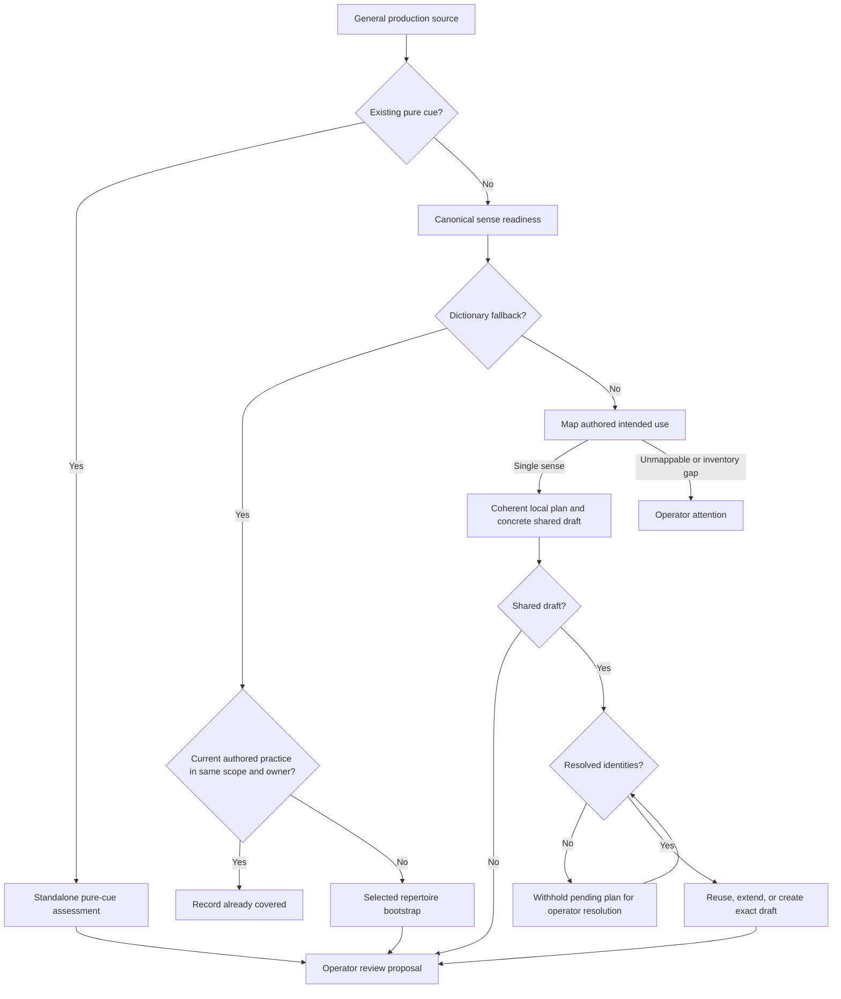

# Vocabulary content-improvement architecture

This reference explains how vocabulary improvement routes source exercises,
retains coherent plans, integrates shared content, and fences publication. The
[architecture contract](../../SPECS/vocabulary-architecture.md) owns authority
boundaries; the [operator workflow](../operator-panel.md#content-improvement-workflow)
explains review controls.

## Reading the flow

- **Sense readiness** reuses canonical inventory. Establishment can request the
  shared inventory/default-useful selection call. Readiness creates senses,
  not teaching or practice content; unresolved legacy state requires operator work.
- **Routing** identifies dictionary fallback sources deterministically. Current
  active authored general production exercises accepting the word, including
  pure cues, count as practice only within the source's publication scope and
  owner. Learner adoption, scheduling, deactivation, and selected serving senses
  do not determine this content lifecycle. Covered fallbacks record no proposal;
  uncovered fallbacks bootstrap selected practice without a mapping model call.
- **Mapping** assesses authored exercises for a single intended use. Related
  glosses do not trigger a laundry-list repertoire route. Unmappable content or
  inventory gaps stop with operator attention. Intended sense is authorial context,
  not a clue the learner necessarily saw.
- **Local planning** trusts selected coverage, judges the original cue foremost,
  and produces one coherent plan: original-source actions, optional response-word
  creations, and an optional complete shared draft. It can retire the original
  without excluding its sense. Raw responses and reactions inform the judgment.
- **Integration** inspects eligible overlapping shared cues. It reuses a compatible
  cue already accepting all candidates, extends a compatible cue preserving all
  existing content except its integrated teaching note, or creates the exact
  upstream draft. It does not repeat the pedagogical decision. Unresolved
  identities withhold the complete plan for operator resolution.
- **Application** requires operator review. Shared changes and local refinements
  form one proposal; reuse is an assessment without a shared edit. Operators can
  trim or edit parts deliberately, including optional clarifiers.

Authored single-sense assessment makes a mapping call and a local planning call,
with one integration call when shared practice is proposed. Fallback bootstrap
uses general-exercise authoring without a mapping or local planning call. Sense
readiness can add a prerequisite inventory call. Completed stages are retained
by exact input and contract. Failed provider work requires explicit retry,
except bounded prerequisite preparation. Source and sense changes fence results.

Only general production encounters enter provider work. Recognition and contrast
remain fully recorded in the session log but create no provider calls, including
within mixed-word feedback aggregation. Teaching issues go to a manual inbox.

## Routing, local planning and shared integration

### Single-word assessment

Single-word local planning preserves the source's answer membership while
proposing wording changes, variants, or retirement. Its `responseExercises`
create word-specific practice only for supplied uniquely resolved raw response
identities. Those exercises have no invented sense association; a later assessment
can establish one. Operators can edit complete authored proposals before preview.
The adapter does not propose sense exclusion or learner suppression.

After sense readiness, deterministic source routing separates dictionary
fallback bootstrap from authored-cue assessment. An uncovered fallback captures
the effective selected senses from defaults or a review override and invokes the
shared general-exercise contract: the full general v5 brief, structured direct
and cloze stimuli, optional teaching notes, and shared validation. It retains the
reflection job's selected model and source publication scope. The first generated
exercise replaces the fallback and others add practice without retiring unrelated
content. Established senses supply uses and retained examples; missing examples
are not invented. An empty selected scope makes no authoring call. Current
same-scope, same-owner authored production practice prevents another bootstrap,
including pure cues accepting the target.

Authored cues instead receive a separate mapping call. A defensible single sense
admits coherent local planning. An uninterpretable source or inventory gap retains
its rationale in operator attention without automatic inventory expansion. No
laundry-list outcome sends authored content to repertoire generation. Learner
feedback and compensation have independent authority.

Selected senses are intentional, including uncommon or personalized uses. The
assessment judges the exact target's contribution rather than deciding whether
the selected meaning is generally useful. Making a compound-fragment cue more
selective is insufficient when it still retrieves a different lexical unit;
genuine construction practice and good direct cues for obscure selected nouns
remain valid. An empty operations array retains the current exercise. A `retire` operation
has an empty wire prompt and retains the source comparison snapshot, identity
and version. Normalization uses that snapshot; source drift is handled by the
publication/approval fences without reclassifying valid provider output as
malformed. It cannot accompany local create/update/replace operations for
that source; response-word creations and a concrete shared draft may accompany it.
Repertoire authoring returns only `exercises`, with no sense-exclusion fields.
Every new automatic item must identify a supplied use; null or unknown references
are rejected rather than assigned an arbitrary sense. Aliases translate back to
canonical bindings before publication/proposal validation. Legacy and manual
unmapped content remain supported by their existing contracts.
An empty model-produced array after a nonempty requested scope records inability
to author faithful exact-target practice and becomes a retirement proposal.
An empty requested scope is a separate no-action outcome. Ordinary preparation
retains an empty recommendation and valid invocation in operator attention,
publishes nothing, and stops automatic retries. An explicit operator retry starts
another bounded cycle without changing selected senses. Reflection retirement
diagnoses disclose that general authoring supplies no explanatory rationale and
report the assessment-time count of other active general production exercises
in the same publication scope, including when retirement would leave none. That
count is context for review rather than a guarantee about later serving.

An operator-requested reassessment creates a separate case and pins the current
exercise identity and version at submission. When it differs from the historical
assessed source version, the operator must confirm the current version before
queueing work. The selected model performs fresh mapping and final assessment,
even for an unchanged source version; the child does not reuse the parent job's
mapping. An authored single-sense assessment can invoke shared integration; a dictionary
fallback uses its deterministic covered-or-bootstrap route. Pure cues use their standalone assessment.
The resulting proposal is based on the pinned current version. The original
encounters, responses and reactions remain model input across reassessment chains,
including historical proposals. The input distinguishes evidence served from the
same source version from historical evidence when the current source has changed.
Successful assessments that need operator attention can also be reassessed.

Within each completion, exercise improvement groups all encounters for the same
exercise identity and served version when any encounter reports an issue. Different
exercises and versions remain separate; retained historical cases are unchanged.
Source version and sense-state fences reject subsequent changes before accepting
results, and proposal application revalidates its bases. Failures remain available
for explicit retry against the same pinned source.

### Existing pure-cue assessment

Existing pure cues use a dedicated standalone `pure-cue-improvement.md` call,
not the generic improvement fallback. Its input supplies complete original
content and current members, projected encounters, and lexical resolutions of
effective rejected responses. Missing or ambiguous lexical identities do not
remove raw-response evidence, but cannot authorize new member IDs. The result
is extension, stimulus repair, or explanation-only. Extension preserves the
stimulus, axis, current members and accepted forms while replacing the complete
teaching note; repair changes only the stimulus. The accumulated teaching note
integrates all members, mostly in English with Chinese where helpful. Both
changes require manual application and leave individual word repertoires alone.
The call uses prompt/schema version 1 and projection `vocabulary-admission.v1`,
retains invocation provenance and source/lexical fences, and does not use the
admission stage-result cache.

### Shared integration and unresolved identities

`single-improvement.md` returns `diagnosis`, source `operations`, create-only
`responseExercises`, and nullable `pureCueReferral`. A referral contains candidate
forms, purpose, rationale, and complete `draft` prompt, semantic axis, and teaching
note. This stage owns useful shared practice and local refinements, including
whether an optional clarifier earns space. It avoids cosmetic exclusive-target
rewrites that the same compared response answers equally well, without demanding
absolute uniqueness against every possible Mandarin answer.

`pure-cue-promotion.ts` resolves forms against exact dictionary identities, using
the source to disambiguate its target, and supplies eligible active overlapping
pure cues in the same publication scope and owner. `pure-cue-integration.md`
receives the assessment, local plan, referral, candidates, and existing cues.
Its only decisions are reuse, extend, and create. The backend supplies all
resolved candidates deterministically. Extension retains every existing member,
accepted form, stimulus, and axis while integrating the note; creation uses the
exact upstream draft. Identity, privacy, and answer-leak guards apply even when
integration selects reuse.

When shared identities are missing or ambiguous, the result retains the complete
local proposal as `pendingPlan` and withholds an actionable partial proposal.
The operator workspace lists exact dictionary matches. Selection through
`POST /api/operator/vocabulary/cases/:id/pure-cue-resolutions` validates the source,
catalog, target mapping, and matching lexical snapshots, then creates a separate
child case/job with an immutable resolution record. The child resumes the saved
plan and integrates shared content into one reviewable proposal; it does not
repeat mapping or local planning. Source and lexical changes fence publication.
Identity resolution never applies content. Failed work can retry its retained
choices; changed evidence requires fresh review.

Persisted pre-plan referrals without an authored draft use the legacy
`pure-cue-promotion.md` contract when identity resolution resumes them. Those
records can reject, reuse, extend, or create and produce promotion-only proposals,
leaving the parent's separate local proposal and editorial changes untouched.
They do not define the current coherent-plan call boundary. Operator editorial
trims and edits to ordinary proposals are deliberate review choices, not automatic
dependencies that integration restores or enforces.

### Versions and retained stage results

`single-improvement.md` uses prompt version 5 and schema version 4;
mapping uses prompt version 4 and schema version 1. Integration uses prompt
version 1 and schema version 3. These calls use `vocabulary-admission.v4`
projection. Repertoire retains general-exercise prompt v5, schema version 2,
and `general-exercises-v2` projection. Legacy promotion uses its retained contract
for pre-plan resolution records.

Stage identity includes exact projected input, schema, prompt contract, and
projection version. Canonical IDs stay in retained evidence while wire inputs
use short sense references; unknown aliases fail validation. Results are reused
within the same job only for the same contract and input. Source, canonical
inventory, mappings, resolved lexical identities, and inspected cue versions fence
publication. Existing saved proposals and second opinions retain their original
versions; a contract upgrade does not regenerate them.

Sense establishment reuses an existing canonical inventory before requesting
the shared inventory/default-selection call. It does not regenerate teaching or
practice content as a side effect. Mapping and generation retain evaluated source
versions and invocation provenance; publication is fenced against changed sources
and maintenance controls. A mapped sense explains authorial intent, not what the
learner was necessarily told by the original cue.

See [worker routing and retry controls](../vocabulary-learning.md#background-work-and-operator-repair)
for model selection, provider gates and preparation retry budgets.

## Queued operator application

Approve and apply persists an exact-version operator request before returning its
acknowledgement. The frontend advances from that receipt and uses queue status
reads to discover completion or attention failures. It does not label a queued
request as applied.

`server/vocabulary/approval-requests.ts` keeps an append-only JSON-lines journal
at `APP_DATA_DIR/vocabulary-approval-requests.jsonl`, alongside the database on
the persistent volume. Memory indexes the journal for scheduling. One worker
processes requests serially and yields between applications; maintenance mode
pauses processing. The worker uses the existing real-writer rollback preview,
source and sense fences, exact-version operator review, and atomic application.
The review and application commit together in SQLite. A stable request-derived
application key lets replay recover the receipt if the SQLite commit succeeded
before the completion journal append.

Only newline-terminated journal records count as committed; startup discards an
incomplete final append and rejects malformed committed records. Periodic atomic
compaction retains pending and attention work plus a recent completion tail.
The journal is outside SQLite and Litestream replication. A lost volume can lose
in-flight authorizations; the proposals remain available in the database for
operator reconciliation. The journal does not request provider calls.

## Dictionary fallback publication scope

Corpus dictionary fallbacks and the repertoires generated from them are shared
authored study content. New fallbacks use a stable shared identity per word, skill
and role. Existing learner-specific fallback identities remain usable to preserve
deactivation and retirement. Composition chooses one stock fallback for each
objective and excludes duplicate stock copies from the shared pool. Authored
variants remain ordinary candidates.

### Compatibility for migration 0058

Migration `0058_shared_dictionary_baselines` positively identifies stock
dictionary fallbacks by their service origin, original identity and unchanged
authored body, assessment and answers. It appends a scope-only shared content
revision while retaining the original identity and historical snapshots.
Unresolved service-generated repertoires whose entire proposal still matches
those source versions receive a new shared proposal revision and updated bases.
Operator-edited proposal revisions are retained for manual reassessment.
Prior approvals and opinions remain bound to the earlier revision; fresh review
is required. Assessed-source provenance retains the version actually examined.
Resolved proposals, edited fallbacks, private imports and unrelated proposals
are retained as recorded. Skipped or substantively stale proposals still require
manual reassessment.

An old encounter can resolve to the audited scope-only successor during review.
This permission requires the migration's revision attribution and unchanged
authored material; a subsequent authored edit retains the normal drift fence.
Encounter evidence, learner state, provider results and stage caches remain
immutable. A second opinion is advisory and does not regenerate a proposal.
The migration makes no provider calls and applies no proposed content.

## Maintaining the flow diagram

The Mermaid diagram above describes the routing maintained by this guide. Update
it with these provider boundaries when routing changes. The checked-in historical
PNG and its renderer are retained artifacts; they do not describe this flow.

## Scoped production coverage

`server/db/vocabulary-sense-coverage.ts` owns nullable shared default-useful IDs,
compatible excluded IDs and review included IDs. A null shared selection is
unknown (`selectionEstablished: false`), while `[]` is explicitly none. A null
review selection inherits defaults; an explicit review selection establishes that
review's effective coverage even when shared defaults remain unknown. Each scope has a compare-and-swap version,
immutable change history and backend events. Mapping still receives every active
sense and no mutable policy metadata. A single mapped sense is the explicit
input to local improvement, even when currently excluded from serving. A
fallback bootstrap captures review IDs or shared defaults once for its
repertoire invocation. A captured scope records whether selection is established. Unknown repertoire
scope initializes shared defaults asynchronously; unresolved findings record `needs_coverage`; an explicit empty scope records `no_senses_requested`,
does not call authoring, and leaves the source active without a proposal.

Admission retains `generationScope`: exact sense IDs plus mapped-source,
review-override or word-default provenance. Captured policy versions are audit
evidence, not approval or publication dependencies. Backend-normalized mapping
evidence persists the first requested scope in the existing stage-result cache;
`canonical-generation-scope-v1` identifies that backend normalization without changing the mapper's wire schema. Retrying the same assessment preserves its
scope and completed content results after serving policy changes. A new
reassessment can request a new scope. Content calls, their cache identities and
publication fences omit mutable serving metadata. Source content, mapping,
canonical catalog and publication-authority fences remain active. Serving policy metadata does not invalidate ordinary content approval/application.

Shared defaults filter mapped general production at `listVocabularyExercises`
and shared production-proxy checks. Established selection admits only active
selected identities; later inventory additions do not become useful implicitly.
Unknown selection preserves the existing exclusion-based serving policy.
General preparation validates the immutable bootstrap document's complete mapped
canonical scope through `legacy_sense_imports`, retaining use/example identities
and exact current canonical versions. Shared useful policy gates only new automatic
demand: unknown policy records a durable prerequisite; explicit none or no source
intersection creates no new authoring demand. The worker initializes unknown
defaults before claiming an authoring attempt. Existing work remains discoverable and runs against its original full document across
policy edits. The generation key contains the source/authoring contract, without
policy versions; source/catalog/version changes still fence publication.
Unmapped content stays eligible under the existing fallback policy. A sense
coverage change does not rewrite content, learner attempts or served snapshots.

Operator GET/PUT routes are `/api/operator/vocabulary/words/:id/sense-coverage`
and `/api/operator/vocabulary/cases/:id/sense-coverage`. PUT requires the current
nonnegative `expectedVersion` and shared `includedSenseIds` (or compatible `excludedSenseIds`), versus nullable
review `includedSenseIds`. Shared exclusion controls explicitly establish the
complementary useful selection; they do not interpret an absent selection. Review reassessment copies overrides into the child case;
proposal edits remain separate editorial inputs and are not reassessment input.

## Explicit retirement proposals

A proposal can `retire` an active general production exercise without creating a
successor. Approval changes only its live availability and version. Its content
identity, schedules, deactivations, teaching references, and historical encounters
remain retained. The content history records the underlying availability update;
the application receipt records the explicit `retire` decision.

Retirement retains a compulsory comparison snapshot, but execution reads the exact
live source rather than applying that snapshot as an authored edit. Preview and
application use the same ordered content transitions; preview rolls back history,
events and writes. A failure in another operation rolls back the entire application.
Sense selection is configured directly through review coverage or word defaults;
content proposals never mutate that policy.

## Shared inventory, useful selection and teaching enrichment

`ensureVocabularySenses` owns the canonical inventory. Fresh lexical words receive
one inventory/default recommendation call using `sense-inventory.md`. Inventory and
nonempty initial useful selection publish atomically. The model's zero-usefulness
finding retains the inventory, stores its recommendation/invocation and leaves
usefulness unknown for operator review. Mapping can still improve a single use.

`ensureVocabularyDefaultUsefulSelection` conditionally initializes unknown defaults.
It selects active teaching-imported identities deterministically when their exact
source links are valid. Inventory-only words use `default-useful-selection.md`, an
adaptation of the inventory brief's full editorial reasoning that only returns
existing sense IDs. The selector cannot rewrite labels, notes, sense versions or
inventory membership. An operator's concurrent selection wins; the recommendation
remains auditable. Explicit `[]` is preserved and suppresses unknown-selection findings.

`vocabulary_default_selection_readiness` gives the selector its own lease and
bounded retry cycle. Inventory and selector attempts share the attempt journal,
with selector work IDs prefixed `default-selection:`. Provider failures retry after
30/60 seconds; exhausted cycles and model-empty recommendations become operator
findings. Maintenance, lost leases and source races defer work under a fresh claim
without invalidating a structurally valid model response. Provider orchestration
and administrative retries live above database persistence modules.

A fallback bootstrap records its deterministic route and captures generation
scope in the retained stage store. Selection initialization can wait or fail
without making a mapping call or invalidating a provider invocation. Captured scope is immutable on retry. Single-sense improvement
never waits for useful selection.

Teaching completion synchronously records general-practice demand in its completion
transaction. When defaults are unknown, `default_selection_pending` marks that work
as a prerequisite rather than an authoring attempt. The practice worker performs
initialization under its provider-work gate, then clears the marker once. Selector
waiting consumes no authoring attempts. Saved operator policy resolves selector
attention and requeues affected prerequisite work. Source mapping failures are
operator-visible, nonretryable findings; source reconciliation is a separate action.

One immutable source has one automatic practice lifecycle across prompt revisions.
Ready pools, including ready-empty results, are reused. Exhausted and in-flight work
are not replaced with new rows or budgets. A queued lifecycle adopts the current
provider contract at claim with an audit event while retaining its identity and
attempt counts. Running work keeps its captured contract. Explicit operator retry
starts a new bounded cycle; prompt revision alone does not.

Bootstrap preflight obtains inventory and useful selection before claiming an
example-enrichment lease. `WordBootstrapInput.canonicalSenses` selects the enrichment
prompt/schema; the independent local lab keeps its inventory experiment. Enrichment
returns exactly the captured IDs and example references; server assembly supplies
canonical labels/notes. Publication checks canonical IDs/versions and catalog, then
records exact immutable `legacy_sense_imports` links before invoking the content
importer in the same transaction. Teaching/review components use document scope and
preflight its current canonical mappings; policy edits do not invalidate components
or change a prepared package's lesson.

Operator workspace and review-batch metadata include a read-only
`defaultSelectionFinding` when model-empty or exhausted initialization needs review.
It carries the reason, recommended IDs and invocation ID, and disappears whenever
an explicit word policy is saved. This finding never blocks single-sense content
approval. [The initialization procedure](../ops/default-useful-selection.md) describes
bounded dry runs, deterministic imports and optional model-backed batches.

Reveal snapshots prefer explicit source-use links in the selected document,
allowing reflection-first canonical senses to obtain later teaching examples
without changing their descriptions or replaying historical encounters. Retained
legacy description-source links remain readable for their original documents.

## Compact proposal editing

Review batches and case workspaces include read-only sense labels alongside the
proposal evidence. Reading these labels does not establish an inventory or select
useful senses. The review groups authored items by their target sense and shows
common answer forms and access scope once. Unmapped items remain in general
practice. Known full sense identifiers and unambiguous eight-character UUID
references become readable labels in visible rationale prose; Details retains the
original explanation and identifiers.

Each item has an inclusion checkbox. Unchecking it removes the operation from the
next saved revision while retaining its edited draft locally until saving or
explicitly leaving the review. Checking it again restores those edits. Excluding
a replacement also excludes that operation's source retirement; the source stays
active. Retirement is an explicit content operation.
No selected operations disables saving and approval; the operator can restore the
selection or dismiss the proposal. Toggling an item never changes sense coverage.

The editor treats direct text and phrase clozes according to their stored
structure. A structured cue edit updates both the visible `body.prompt` and its
`body.stimulus`; frame and cloze text are separate fields. Legacy prompt-only
content retains its shape. Other structured stimulus kinds remain available in
the full JSON disclosure. Background refreshes do not replace an unsaved draft,
and failed save requests retain edits and item selection.

The operator keeps the full operation pool and a separate inclusion set until a
save succeeds. Saving submits selected operations while retaining explicit
`bases`: those bases also name evidence used to assess the proposal, including a
source whose replacement was excluded. An actual evidence-version change thus
requires review even when the remaining operation creates independent content.
The operator can inspect and edit explicit evidence in the full draft.

Server validation enforces the single-blank phrase-cloze contract
on proposal save and content writes, including preview/application. Retirement
uses its live source snapshot and can remove an invalid exercise without
requiring an authored cue repair.
