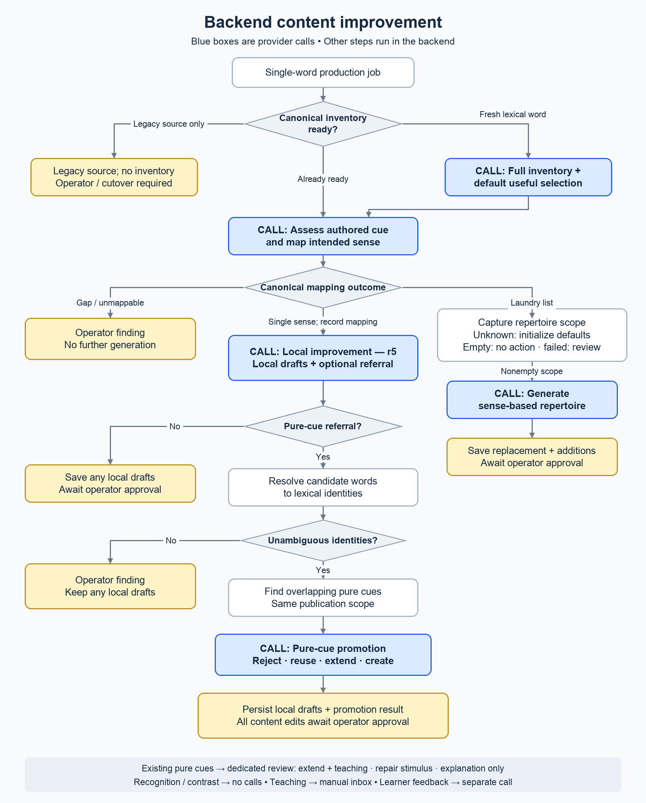

# Vocabulary content-improvement architecture

The adaptive vocabulary content-improvement pipeline separates sense admission,
local exercise repair, optional pure-cue promotion, and existing pure-cue review.
This architecture reference shows provider-call boundaries and the authority of their outputs. Implementation
and release readiness are tracked separately.



## Reading the flow

- **Sense readiness** reuses an established inventory or imports usable bootstrap
  uses without a provider call. Otherwise, it requests a sense-only inventory.
  Partial or inconsistent inventories require operator inspection.
- **Mapping** assesses the authored exercise. A single intended sense admits local
  improvement; a laundry list routes to a fresh repertoire. An unmappable cue or
  inventory gap stops generation with an operator finding. The mapped sense is
  authorial context, not a clue the learner necessarily saw.
- **Local improvement** preserves that sense and the exercise's accepted answers.
  Local drafts and a pure-cue referral are independently optional. Raw responses
  and learner reactions inform assessment without dictating the result.
- **Promotion** resolves referral words to lexical identities and examines
  overlapping pure cues in the same publication scope. It can reject the referral,
  reuse a suitable cue, extend membership and update its integrated teaching note,
  or propose a new cue. Extension preserves the stimulus, axis and existing answers.
  Promotion does not reconcile individual words'
  exercise collections. Unresolved identities retain an operator finding and any
  local drafts.
- **Application** remains operator-controlled. New or extended pure cues join any
  local repairs in a reviewable proposal. Reuse and rejection are retained
  assessments; neither publishes an edit.

The ordinary single-sense path makes two calls, or three with promotion, plus one
if sense generation is necessary. Completed admission stages are retained by exact
input and contract, so an unchanged retry reuses their outputs. Failed provider
work requires explicit retry, except sense preparation, which retries automatically
within its three-attempt cycle. Source and sense changes fence stale results.

Only general production encounters enter provider work. Recognition and contrast
remain fully recorded in the session log but create no provider calls, including
within mixed-word feedback aggregation. Teaching issues go to a manual inbox.
The old generic improvement fallback is no longer dispatched.

An existing pure cue uses one dedicated `pure-cue-improvement.md` call. It receives
complete authored content, original current members, projected encounter evidence,
and lexical resolutions of effective rejected responses. Missing or ambiguous
identities remain useful raw-response evidence but cannot supply extension IDs.
It proposes extension, stimulus repair, or explanation-only. Extension preserves
the stimulus, axis and existing answers, and replaces the accumulated teaching
note; repair preserves the axis, membership and note. Both pure-cue paths require
manual application and leave individual word repertoires alone. Shared teaching
notes are mostly English, with Chinese where useful to illustrate the point.

Existing pure-cue review uses prompt/schema version 1 and input projection
`vocabulary-admission.v1`; promotion uses prompt version 3 and schema version 2 with that same
projection and requires teaching notes for creation and extension. Admission and
promotion retain stage results for unchanged retries; existing pure-cue review
retains invocation provenance without that stage-result cache. Learner-facing
feedback and scheduling compensation run through an independent feedback job.

See the [vocabulary contract](../../SPECS/vocabulary-learning.md) for learning and
review authority, and the [implementation guide](../vocabulary-learning.md) for
runtime details.

## Operator review

The operator panel's Content improvement tab presents an Awaiting review queue,
an attention inbox and Archive. Cards keep scope and identity consequences
visible before approval; one Details disclosure contains full rationale,
relationship effects, encounter history, optional review notes and source-based
manual authoring. Edit proposal edits the displayed draft. Creating a separate
correction starts a new proposal from the current source.

Left and Right navigate the displayed queue while preserving text editing and
native control keys. Each queue remembers its selected identity while moving
between queues; the operator panel keeps the review mounted while visiting Usage
or another operator tab. The cursor survives these visits for the current panel
session. Archive defaults to resolutions from the last 12 hours, using receipt or closure
event timestamps. Search spans all loaded resolved proposals and closed no-change
reviews. Records without retained resolution timestamps are searchable but do not
enter the default time window.

Queue lists refresh every 15 seconds while the panel and document are visible,
and on window focus or visibility change. Refresh pauses during work or unsaved
draft edits and never installs a different proposal version. A changed selected
proposal requires explicit reload and validation before applying. Pending second
opinions use their existing three-second polling cycle. These are reads; provider
retry and application remain explicit operator actions.

## Updating the picture

The [rendering source](../diagrams/render-content-improvement-flow.py) keeps layout,
labels, and colors editable. Regenerate the checked-in PNG with Python and Pillow:

```sh
python3 docs/diagrams/render-content-improvement-flow.py
```

The renderer uses Arial on macOS or DejaVu Sans elsewhere; `--font` and
`--bold-font` accept alternate TrueType font paths. Inspect the rendered image
when changing labels or routing, and keep this explanation aligned with it.
