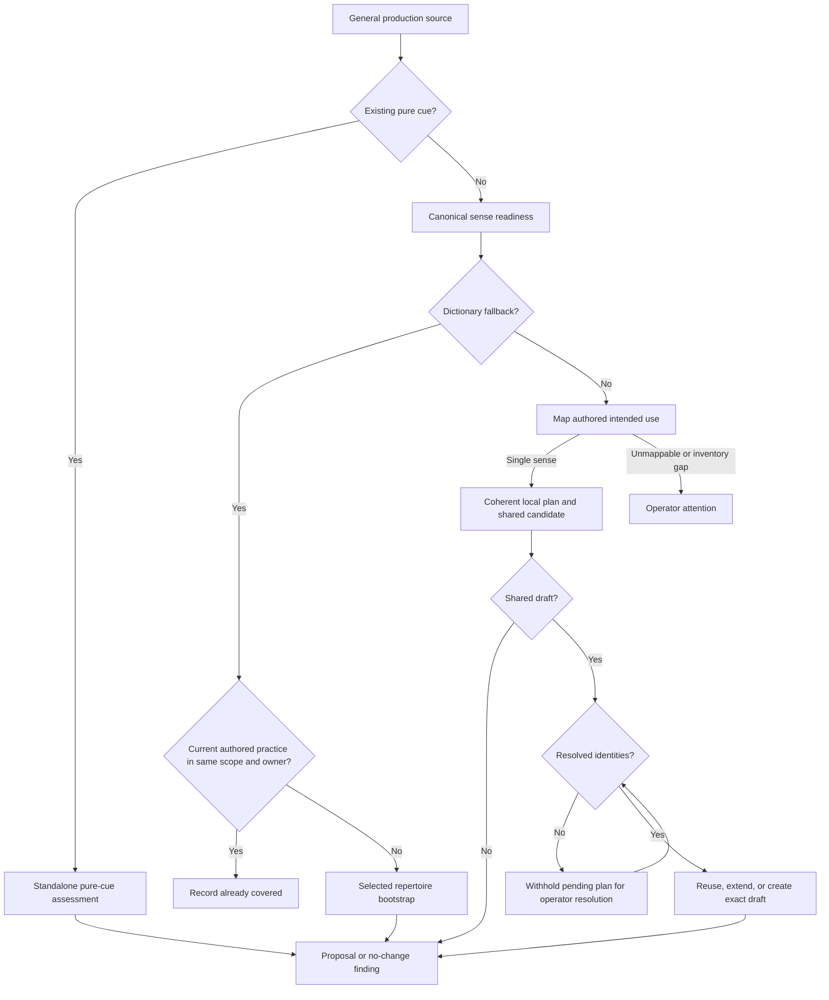

# Vocabulary content-improvement architecture

This reference explains how vocabulary improvement routes source exercises,
retains coherent plans, integrates shared content, and fences publication. The
[architecture contract](../../SPECS/vocabulary-architecture.md) owns authority
boundaries; the [operator workflow](../operator-panel.md#content-improvement-workflow)
explains review controls.

## Sense/content reconciliation

The matcher embedded in **Content improvement → Needs attention** compares prepared
teaching with canonical senses. `/operator/reconciliation` is a compatibility entry
to that queue. It addresses source disagreement rather than asking ordinary
exercise improvement to silently choose a winner. The
[contract](../../SPECS/sense-content-reconciliation.md) owns the semantic decisions;
[`sense-content-reconciliation.ts`](../../server/db/sense-content-reconciliation.ts)
owns saved judgments and live application. It reuses inventory snapshot/dependency
collection from the offline reconciliation report, without invoking that tool's
stopped-writer apply operation. Online snapshots collect the dependencies used by
the application plan; the offline report additionally audits preserved learner
history. Relational dependency reads are scoped to the word and affected content
closure. Embedded JSON references still require discovery scans so indirect
dependencies are retained. Opening a workspace uses a read transaction, and saving
a judgment reuses its checked dependency snapshot when returning the workspace.

[`vocabulary-attention.ts`](../../server/db/vocabulary-attention.ts) projects a stable
`reconciliation:<wordId>` item for a current source mismatch, a saved decision, or
an incomplete applied replacement. It groups preparation failures whose source is
covered by that current/reviewed resolution, regardless of error label. Failures
on sources outside the resolution and unrelated reflection cases remain separate. Source identity and individual failure records
are disclosed as children. Grouping affects the queue projection, preserving the
underlying records and history. Completed replacements remove covered failures
from active attention; a new mismatch or decision can keep the word actionable.
Queue counting and pagination operate on grouped identities before displayed
items load their progress and child records. Reconciliation groups and failures
are fetched in page-sized batches rather than rerunning the queue projection for
each displayed word.

Each saved version captures a linguistic draft and source snapshot. Planning checks
use accounting, selected identities, source drift, active generation, unresolved
proposals/jobs, private dependencies and an active replacement requester. Blockers
are durable judgments plus computed capability/dependency findings, not provider
failures. The handler regenerates the affected teaching unit. When every selected
default sense has at least one mapped teaching use, it carries compatible general
repertoire forward and skips practice generation. Teaching-bound exercises remain
part of teaching replacement. Current exercise sense links follow unambiguous
operator mappings; ambiguous translations block application. Immutable source
documents, import mappings and historical generation provenance remain unchanged.
When a selected sense has no mapped use, the handler requests full selected-scope
practice generation and retires affected source-dependent repertoire.

Apply rechecks the reviewed fingerprint under an immediate transaction, retires the
source/package and affected content closure, updates defaults if changed, resets and
queues replacement teaching, and stores applied authority. Exact replay is idempotent.
Neither saving nor applying changes learner progress or captured session payloads.

[`sense-content-reconciliation-state.ts`](../../server/db/sense-content-reconciliation-state.ts)
compares replacement scope/mappings and publication state with the applied authority.
The shared authoring and general-practice paths capture reconciliation identity and
check it before publication. Applied reconciliation immediately supplies durable
practice demand from its selected canonical sense snapshot only when its recorded
plan requires practice replacement. A carry-forward plan suppresses both canonical
and ordinary teaching-triggered bootstrap under that applied authority, including
after teaching completion. Practice authoring does
not read or wait for replacement teaching; both replacements are checked against
the same applied authority. The existing first-learning path still authors from
its teaching source. Replacement teaching becoming ready does not request a second
repertoire bootstrap after reconciliation practice has already completed.
Fresh session composition, shared cues and contrast choices exclude affected words
while replacement is pending or failed. Retained sessions use their original payload.
Canonical/default changes during replacement require another resolution; a later
draft does not remove the previous applied gate. A completed reconciliation receipt
ends that replacement gate rather than permanently freezing future default edits.

## Reading the flow

- **Sense readiness** reuses canonical inventory. Establishment can request the
  shared inventory/default-useful selection call. Readiness creates senses,
  not teaching or practice content; unresolved legacy state requires operator work.
- **Routing** identifies dictionary fallback sources deterministically. Current
  active authored general production exercises accepting the word, including
  pure cues, count as practice only within the source's publication scope and
  owner. Learner adoption, scheduling, deactivation, and selected serving senses
  do not determine this content lifecycle. Covered fallbacks record no proposal;
  uncovered fallbacks bootstrap selected practice without a mapping model call.
- **Mapping** identifies the intended use of an authored exercise and compares it
  with the supplied inventory. Unmappable content or inventory gaps stop with operator attention. Intended sense is authorial context,
  not a clue the learner necessarily saw.
- **Local planning** receives the mapped intended use, judges the original cue,
  and produces one coherent plan: a source decision, additional target or
  response-word exercises, and an optional shared-practice candidate. It can retire the original
  without excluding its sense. Raw responses and reactions inform the judgment.
- **Integration** inspects eligible overlapping shared cues. It reuses a compatible
  cue already accepting all candidates, extends a compatible cue preserving all
  existing content except its integrated teaching note, or authors a new stimulus,
  axis, and note realizing the nominated shared purpose. It can refine the
  candidate's presentation but does not repeat the pedagogical decision. Unresolved
  identities withhold the complete plan for operator resolution.
- **Application** requires operator review. Shared changes and local refinements
  form one proposal; reuse is an assessment without a shared edit. Operators can
  trim or edit parts deliberately, including optional clarifiers.

Authored single-sense assessment makes a mapping call and a local planning call,
with one integration call when shared practice is proposed. Fallback bootstrap
uses general-exercise authoring without a mapping or local planning call. Sense
readiness can add a prerequisite inventory call. Completed stages are retained
by exact input and contract. Failed provider work requires explicit retry,
except bounded prerequisite preparation. Source and sense changes fence results.

Only general production encounters enter provider work. Recognition and contrast
remain fully recorded in the session log but create no provider calls, including
within mixed-word feedback aggregation. Teaching issues go to a manual inbox.

## Routing, local planning and shared integration

### Exercise-local authoring

Single-word planning returns `{summary, source, sharedExercise, additionalExercises}`.
The source decision is `keep`, `revise`, or `retire`; only revision carries a
prompt. Shared practice includes its actual cue, answer references, teaching
note, and rationale. Additions use the same fields for target and response words,
with a `refinement` or `enrichment` role. Refinements develop a distinctive use
within the originating circumstance. Enrichment retains helpful examples surfaced
by the assessment or answers a learner request; it does not trigger a separate
search, and follows the same answer-fairness standard.

`exercise-improvement-authoring.ts` presents the source and encounters separately,
with intended-use description and supplied word references (`target`, `response_1`,
and so on). The model receives readable lexical information when a word is
uniquely identified. The adapter supplies stored source versions and
accepted forms when it translates the output into operations. Individual additions
and shared answers require `canAuthorIndividual: true`. Missing or ambiguous
forms remain encounter evidence for diagnosis and target improvement; validation
rejects their use as proposed answers.
`revise` maps to `update_existing`, preserving identity and existing learner
controls. The application retains its internal operation format; the model does
not choose storage operations. Optional `learningRole` metadata lets the operator
review identify source repair, shared practice, refinements, and enrichment.
Old proposals without that metadata remain editable.

Source repairs and all target additions, including optional enrichment, receive
the source's mapped sense and mapping timestamp. This assumes the additional
target practice develops the same sense. Response-word additions receive no
invented sense association; a later assessment can establish one. Operators can
edit complete authored proposals before preview. The adapter does not propose sense exclusion or learner
suppression.

The mapped intended use can be uncommon or excluded from current serving
coverage. Local assessment judges the exact target's contribution within that
use; it does not receive or revise serving selections. Making a compound-fragment
cue more selective is insufficient when it still retrieves a different lexical unit;
genuine construction practice and good direct cues for obscure selected nouns
remain valid. A `keep` decision retains the source; `retire` removes that
exercise while allowing additional target or response-word practice and a shared
cue. Both decisions use a null authored prompt. Normalization retains the source
comparison snapshot, identity and version; source drift is handled by the
publication/approval fences without reclassifying valid provider output as malformed.

### Dictionary fallback and sense mapping

After sense readiness, deterministic source routing separates dictionary
fallback bootstrap from authored-cue assessment. An uncovered fallback captures
the selected senses from shared word defaults and invokes the
shared general-exercise contract: the full general v5 brief, structured direct
and cloze stimuli, optional teaching notes, and shared validation. It retains the
reflection job's selected model and source publication scope. The first generated
exercise replaces the fallback and others add practice without retiring unrelated
content. Established senses supply uses and retained examples; missing examples
are not invented. An empty selected scope makes no authoring call. Current
same-scope, same-owner authored production practice prevents another bootstrap,
including pure cues accepting the target.

Authored cues instead receive a separate mapping call. A defensible single sense
admits coherent local planning. An uninterpretable source or inventory gap retains
its rationale in operator attention without automatic inventory expansion. The
three outcomes are `single_sense`, `inventory_gap`, and `unmappable`. Learner
feedback and compensation have independent authority.

### Repertoire authoring outcomes

Repertoire authoring returns only `exercises`, with no sense-exclusion fields.
Every new automatic item must identify a supplied use; null or unknown references
are rejected rather than assigned an arbitrary sense. Aliases translate back to
canonical bindings before publication/proposal validation. Legacy and manual
unmapped content remain supported by their existing contracts.
An empty model-produced array after a nonempty requested scope records inability
to author faithful exact-target practice and becomes a retirement proposal.
An empty requested scope is a separate no-action outcome. Ordinary preparation
retains an empty recommendation and valid invocation in operator attention,
publishes nothing, and stops automatic retries. An explicit operator retry starts
another bounded cycle without changing selected senses. Reflection retirement
diagnoses disclose that general authoring supplies no explanatory rationale and
report the assessment-time count of other active general production exercises
in the same publication scope, including when retirement would leave none. That
count is context for review rather than a guarantee about later serving.

### Encounter grouping and reassessment

An operator-requested reassessment creates a numbered job within the same
canonical review case and pins the current exercise identity and version at
submission. When it differs from the historical
assessed source version, the operator must confirm the current version before
queueing work. It requests fresh mapping where applicable and authors a fresh
assessment with the selected model, even for an unchanged source version; the
new job does not reuse the previous job's mapping. An authored single-sense
assessment can invoke shared integration; a dictionary
fallback uses its deterministic covered-or-bootstrap route. Pure cues use their standalone assessment.
The resulting proposal is based on the pinned current version. The original
encounters, responses and reactions remain model input across reassessment chains,
including historical proposals. The input supplies the current source separately
from each encounter's frozen served cue, responses, and effective reactions. It
identifies operator reassessment as the assessment origin. Stored versions support the backend consistency checks.
Successful assessments that need operator attention can also be reassessed.

Within each completion, exercise improvement groups all encounters for the same
exercise identity and served version when any encounter reports an issue. Different
exercises and versions remain separate; retained historical cases are unchanged.
Source version and sense-state fences reject subsequent changes before accepting
results, and proposal application revalidates its bases. Failures remain available
for explicit retry against the same pinned source.

Canonical review ownership lives in `vocabulary_case_reviews`; its current job
and proposal pointers select the authoritative review material. Historical child
cases remain in `reflection_cases`, linked through `vocabulary_case_lineage`.
Jobs retain original historical references and have a canonical `review_case_id`
and `case_sequence`. New jobs use the canonical case directly. Generated
proposals retain `assessment_job_id`, so viewing or reviewing an older proposal
uses its own assessment provenance. Provider retry count remains separate from
the holistic job sequence. A partial unique index admits only one queued/running
job per canonical case.

Reassessment freezes proposal saves, dismissal, approval, case resolution, and
repair-target edits. A failed or expired job releases that freeze without replacing
the current result. A successful authoritative result changes current pointers
and supersedes the previous current proposal atomically; retained alternatives
remain explicitly unresolved until reviewed. Advisory opinions never change
those pointers. Case versions change with job transitions, proposal revisions,
and review decisions. Approval journal replay reconstructs pending locks and
clears orphan admission intents; failed approvals have a separate attention
state and can be corrected or reassessed. Successful application resolves a case
only when no unresolved alternative proposal remains.

### Existing pure-cue assessment

Existing pure cues use a dedicated standalone `pure-cue-improvement.md` call,
not the generic improvement fallback. Its input supplies complete original
content and current members, projected encounters, and lexical resolutions of
effective rejected responses. Missing or ambiguous lexical identities do not
remove raw-response evidence, but cannot authorize new member IDs. The result
is extension, stimulus repair, or explanation-only. Extension preserves the
stimulus, axis, current members and accepted forms while replacing the complete
teaching note; repair changes only the stimulus. The accumulated teaching note
integrates all members, mostly in English with Chinese where helpful. Both
changes require manual application and leave individual word repertoires alone.
The call uses prompt version 2, schema version 1, and projection `vocabulary-admission.v2`,
retains invocation provenance and source/lexical fences, and does not use the
admission stage-result cache.

### Shared integration and unresolved identities

`single-improvement.md` owns the pedagogical judgment and nominates a shared
candidate with answers, a cue, and a rationale describing its expressive purpose.
It does not author the final axis or teaching note. The adapter translates supplied answer references into the
internal referral used for integration; this persistence boundary does not appear
in the authoring prompt. A short `summary` carries the
overall operator recommendation. Each exercise's rationale explains its own
contribution. The separately stored integration rationale is not appended to the
operator summary.

`exercise-improvement-authoring.ts` uses the shared response lookup to trim
submitted forms and match each exactly against `lexical_words.hanzi` or
`traditional`. One matching record supplies a lexical identity and permits both
individual authoring and inclusion as a shared answer. Zero matches (such as a
missing entry or nonmatching response) and multiple matches leave the identity unresolved.
Several senses within one record do not create this ambiguity. The target already
has an identity through its source exercise. Contextual disambiguation is not part
of this lookup; the model receives the raw form as encounter evidence even when
no identity is supplied.

`pure-cue-promotion.ts` uses the same exact-form lookup for shared candidates and
supplies eligible active overlapping pure cues in the same publication scope and owner. `pure-cue-integration.md`
receives the assessment, local plan, referral, candidates, and existing cues.
Its only decisions are reuse, extend, and create. The backend supplies all
resolved candidates deterministically. Extension retains every existing member,
accepted form, stimulus, and axis while integrating the note; creation authors
the final prompt, semantic axis, and teaching note. The candidate's presentation
can change while its nominated meaning and membership are preserved. The adapter
retains the candidate rationale as shared-purpose context rather than copying its
example sentence into that field. Nomination guards check identity and privacy
before integration. A visible accepted form blocks a direct cue. For flat
prompts, the same blank parser used to render the cue identifies clozes and
allows accepted forms in their context. Lookup remains bounded to eligible cues
sharing an incoming member; semantic similarity without member overlap is not a
retrieval mechanism. Destination judgment compares expressive purposes and actual
stimulus compatibility, rather than requiring identical example scenes.

Historical saved assessments can contain shared answers whose identities are
missing or ambiguous. Their complete local proposal is retained as `pendingPlan`
until identity resolution; current authoring does not produce such plans.
The operator workspace lists exact dictionary matches. Multiple matches can be
resolved by selecting one. With no match, the selector cannot create or substitute
an entry; it offers reassessment or closing the assessment. Selection through
`POST /api/operator/vocabulary/cases/:id/pure-cue-resolutions` validates the source,
catalog, target mapping, and matching lexical snapshots, then creates the next
case job with an immutable resolution record. The job resumes the saved
plan and integrates shared content into one reviewable proposal; it does not
repeat mapping or local planning. Source and lexical changes fence publication.
Identity resolution never applies content. Failed work can retry its retained
choices; changed evidence requires fresh review.

Persisted pre-plan referrals without an authored draft use the legacy
`pure-cue-promotion.md` contract when identity resolution resumes them. Those
records can reject, reuse, extend, or create and produce promotion-only proposals,
leaving the parent's separate local proposal and editorial changes untouched.
They do not define the current coherent-plan call boundary. Operator editorial
trims and edits to ordinary proposals are deliberate review choices, not automatic
dependencies that integration restores or enforces. Historical pending plans
with an authored axis are supported, as are saved proposals without learning-role
metadata.

### Versions and retained stage results

The [prompt contract guide](../../server/vocabulary/reflection-prompts/README.md)
records the active prompt, schema, and input-projection versions for each call.
The provider retains those versions with the exact invocation content.

Stage identity includes exact projected input, schema, prompt contract, and
projection version. Canonical IDs stay in retained evidence while wire inputs
use short sense references for mapping and supplied word references for
exercise authoring; unknown aliases fail validation. Results are reused
within the same job only for the same contract and input. Source, canonical
inventory, mappings, resolved lexical identities, and inspected cue versions fence
publication. Existing saved proposals and second opinions retain their original
versions; a contract upgrade does not regenerate them.

Sense establishment reuses an existing canonical inventory before requesting
the shared inventory/default-selection call. It does not regenerate teaching or
practice content as a side effect. Mapping and generation retain evaluated source
versions and invocation provenance; publication is fenced against changed sources
and maintenance controls. A mapped sense explains authorial intent, not what the
learner was necessarily told by the original cue.

See [worker routing and retry controls](../vocabulary-learning.md#background-work-and-operator-repair)
for model selection, provider gates and preparation retry budgets.

## Queued operator application

Approve and apply persists an exact-version operator request before returning its
acknowledgement. The frontend advances from that receipt and uses queue status
reads to discover completion or attention failures. It does not label a queued
request as applied.

`server/vocabulary/approval-requests.ts` keeps an append-only JSON-lines journal
at `APP_DATA_DIR/vocabulary-approval-requests.jsonl`, alongside the database on
the persistent volume. Memory indexes the journal for scheduling. One worker
processes requests serially and yields between applications; maintenance mode
pauses processing. The worker uses the existing real-writer rollback preview,
source and sense fences, exact-version operator review, and atomic application.
The review and application commit together in SQLite. A stable request-derived
application key lets replay recover the receipt if the SQLite commit succeeded
before the completion journal append.

Only newline-terminated journal records count as committed; startup discards an
incomplete final append and rejects malformed committed records. Periodic atomic
compaction retains pending and attention work plus a recent completion tail.
The journal is outside SQLite and Litestream replication. A lost volume can lose
in-flight authorizations; the proposals remain available in the database for
operator reconciliation. The journal does not request provider calls.

## Dictionary fallback publication scope

Corpus dictionary fallbacks and the repertoires generated from them are shared
authored study content. New fallbacks use a stable shared identity per word, skill
and role. Existing learner-specific fallback identities remain usable to preserve
deactivation and retirement. Composition chooses one stock fallback for each
objective and excludes duplicate stock copies from the shared pool. Authored
variants remain ordinary candidates.

### Compatibility for migration 0058

Migration `0058_shared_dictionary_baselines` positively identifies stock
dictionary fallbacks by their service origin, original identity and unchanged
authored body, assessment and answers. It appends a scope-only shared content
revision while retaining the original identity and historical snapshots.
Unresolved service-generated repertoires whose entire proposal still matches
those source versions receive a new shared proposal revision and updated bases.
Operator-edited proposal revisions are retained for manual reassessment.
Prior approvals and opinions remain bound to the earlier revision; fresh review
is required. Assessed-source provenance retains the version actually examined.
Resolved proposals, edited fallbacks, private imports and unrelated proposals
are retained as recorded. Skipped or substantively stale proposals still require
manual reassessment.

An old encounter can resolve to the audited scope-only successor during review.
This permission requires the migration's revision attribution and unchanged
authored material; a subsequent authored edit retains the normal drift fence.
Encounter evidence, learner state, provider results and stage caches remain
immutable. A second opinion is advisory and does not regenerate a proposal.
The migration makes no provider calls and applies no proposed content.

## Scoped production coverage

`server/db/vocabulary-sense-coverage.ts` owns nullable shared default-useful IDs
and compatible excluded IDs. Null is unknown; `[]` explicitly selects none.
Word selection has a compare-and-swap version, immutable change history and
backend events. Historical case scope rows are retained but do not resolve policy.
In coverage review, **No useful senses** saves an explicit empty selection and
excludes individual-word production from Practice and Maintain for all learners.
Mapping receives every active sense and no serving-policy metadata. Its chosen
sense is evidence for a proposed repair, including excluded uses; assessment
never writes the source mapping. Proposal application commits the reviewed binding
and authored content together. Preview uses the same transitions and rolls back.

Fallback bootstrap captures shared defaults once for its repertoire invocation.
Unknown defaults initialize asynchronously; unresolved selection records
`needs_coverage`. An explicitly empty scope records `no_senses_requested` without
authoring or retiring the source. `generationScope` retains the invocation's exact
sense IDs and provenance. Retries keep those inputs even after policy edits.
Source, mapping, catalog and publication-authority checks still guard application.

The repertoire editor saves shared defaults and proposal selection atomically
through `saveRepertoireWordDefaults`. Proposal revision history retains excluded
exercises; selection revisions in `vocabulary_repertoire_revisions` distinguish
selection changes from authored edits. Reselecting a sense restores its retained
exercises, while manual edits to included exercises survive later selection changes.
The new proposal version contains only included operations, so application writes
only the exercises shown. An intended source replacement is preserved without
altering the source before application. Newly selected senses without retained
exercises require generation. An empty result rejects the entire save and requires
dismissal or new generation, never a synthesized retirement.

`saveRepertoireWordDefaultsAndReassess` provides the explicit generation path.
A savepoint covers defaults, version-checked exact-origin reassessment admission,
and an `operator-repertoire-selection-v1` capture in `vocabulary_improvement_stages`.
The worker validates its word/catalog and active senses, then uses that scope rather
than rereading defaults. Retries keep the capture. Publication checks the resulting
admission against the capture before replacing the earlier proposal. Queue failure
rolls back defaults; later generation failure keeps the saved policy and restores
review of the retained proposal.

`vocabulary_case_repair_targets` holds versioned pending and accepted single-sense
intent. Reassessment captures that intent in the job's `repair_target_json`, skips
automated mapping, and authors against the specified active sense. Pending intent
blocks proposal editing/application, including retained alternatives. Reset clears
only the pending choice. Successful result publication accepts the captured intent
atomically, even for a no-repair judgment, and older proposals remain ineligible;
a failed job leaves the intent pending. Manual binding changes cannot bypass this
path. Case versions also change when intent changes.

Shared defaults filter mapped general production at `listVocabularyExercises`
and shared production-proxy checks. Established selection admits only active
selected identities; later inventory additions do not become useful implicitly.
Unknown selection preserves the existing exclusion-based serving policy.
General preparation validates the immutable bootstrap document's complete mapped
canonical scope through `legacy_sense_imports`, retaining use/example identities
and exact current canonical versions. Shared useful policy gates only new automatic
demand: unknown policy records a durable prerequisite; explicit none or no source
intersection creates no new authoring demand. The worker initializes unknown
defaults before claiming an authoring attempt. Existing work remains discoverable and runs against its original full document across
policy edits. The generation key contains the source/authoring contract, without
policy versions; source/catalog/version changes still fence publication.
Unmapped content stays eligible under the existing fallback policy. A sense
coverage change does not rewrite content, learner attempts or served snapshots.

Operator word selection uses `/api/operator/vocabulary/words/:id/sense-coverage`.
Pending repair intent uses `/api/operator/vocabulary/cases/:id/repair-target`.
Both require expected versions; the latter accepts a sense ID or null to reset.
Reassess opens a compact dialog containing word-case target controls, the model
picker, and submission. Pure-cue cases omit the word target editor and use their
standalone assessment path. Closing it preserves saved pending target intent; the Reassess button
marks that pending state and reopens access to Reset. Unknown target state does not
block Apply/Edit locally; backend mutation checks remain authoritative and their
errors appear in the review. A failed refresh retains the last known target state
for the same case, including a pending restriction. Background queue refresh
pauses while the dialog is open. Reassessment freezes target edits while queued or running. Manual proposal text
edits are available only with a settled assessed target and remain separate from
reassessment input.

## Explicit retirement proposals

For an unresolved sense or inventory gap on an unchanged, active exercise,
**Retire exercise…** on the case card creates an operator retirement proposal.
The operator reviews and applies it through the ordinary approval flow.

A proposal can `retire` an active general production exercise without creating a
successor. Approval changes only its live availability and version. Its content
identity, schedules, deactivations, teaching references, and historical encounters
remain retained. The content history records the underlying availability update;
the application receipt records the explicit `retire` decision.

Retirement retains a compulsory comparison snapshot, but execution reads the exact
live source rather than applying that snapshot as an authored edit. Preview and
application use the same ordered content transitions; preview rolls back history,
events and writes. A failure in another operation rolls back the entire application.
Shared sense selection is configured directly through word defaults;
content proposals never mutate that policy. The compact repertoire card exposes
Selected senses as toggle chips directly above its proposed sense groups. Operators can save the
shared selection and update the proposal together without opening the full detail
editor. Removed groups return when their senses are reselected and saved. New senses can be saved with an explicit reassessment and model choice. Unsaved selection edits block case navigation
and proposal actions until saved or discarded.

## Shared inventory, useful selection and teaching enrichment

`ensureVocabularySenses` owns the canonical inventory. Fresh lexical words receive
one inventory/default recommendation call using `sense-inventory.md`. Inventory and
nonempty initial useful selection publish atomically. The model's zero-usefulness
finding retains the inventory, stores its recommendation/invocation and leaves
usefulness unknown for operator review. Mapping can still improve a single use.

`ensureVocabularyDefaultUsefulSelection` conditionally initializes unknown defaults.
Every established nonempty inventory uses `default-useful-selection.md`, including
teaching-imported senses. The prompt adapts the inventory brief's full editorial
reasoning and only returns existing sense IDs. Teaching source mappings remain
preparation prerequisites; their absence or staleness does not block default
selection over an established canonical inventory. The selector cannot rewrite labels, notes, sense versions or
inventory membership. An operator's concurrent selection wins; the recommendation
remains auditable. Explicit `[]` is preserved and suppresses unknown-selection findings.

`vocabulary_default_selection_readiness` gives the selector its own lease and
bounded retry cycle. Inventory and selector attempts share the attempt journal,
with selector work IDs prefixed `default-selection:`. Provider failures retry after
30/60 seconds; exhausted cycles and model-empty recommendations become operator
findings. Maintenance, lost leases and source races defer work under a fresh claim
without invalidating a structurally valid model response. Provider orchestration
and administrative retries live above database persistence modules.

A fallback bootstrap records its deterministic route and captures generation
scope in the retained stage store. Selection initialization can wait or fail
without making a mapping call or invalidating a provider invocation. Captured scope is immutable on retry. Single-sense improvement
never waits for useful selection.

Teaching completion synchronously records general-practice demand in its completion
transaction. When defaults are unknown, `default_selection_pending` marks that work
as a prerequisite rather than an authoring attempt. The practice worker performs
initialization under its provider-work gate, then clears the marker once. Selector
waiting consumes no authoring attempts. Saved operator policy resolves selector
attention and requeues affected prerequisite work. Source mapping failures are
operator-visible, nonretryable findings; source reconciliation is a separate action.

One immutable source has one automatic practice lifecycle across prompt revisions.
Ready pools, including ready-empty results, are reused. Exhausted and in-flight work
are not replaced with new rows or budgets. A queued lifecycle adopts the current
provider contract at claim with an audit event while retaining its identity and
attempt counts. Running work keeps its captured contract. Explicit operator retry
starts a new bounded cycle; prompt revision alone does not.

Bootstrap preflight obtains inventory and useful selection before claiming an
example-enrichment lease. `WordBootstrapInput.canonicalSenses` selects the enrichment
prompt/schema; the independent local lab keeps its inventory experiment. Enrichment
returns exactly the captured IDs and example references; server assembly supplies
canonical labels/notes. Publication checks canonical IDs/versions and catalog, then
records exact immutable `legacy_sense_imports` links before invoking the content
importer in the same transaction. Teaching/review components use document scope and
preflight its current canonical mappings; policy edits do not invalidate components
or change a prepared package's lesson.

Operator workspace and review-batch metadata include a read-only
`defaultSelectionFinding` when model-empty or exhausted initialization needs review.
It carries the reason, recommended IDs and invocation ID, and disappears whenever
an explicit word policy is saved. This finding never blocks single-sense content
approval.

Reveal snapshots prefer explicit source-use links in the selected document,
allowing reflection-first canonical senses to obtain later teaching examples
without changing their descriptions or replaying historical encounters. Retained
legacy description-source links remain readable for their original documents.

## Case queue and full review workspace

`VocabularyCaseReviewPage` consumes the display-only `VocabularyCaseQueueItem`
projection from the case queue API. `CaseReviewCard` renders the served prompt,
response/reaction summaries, assessment-associated provenance, and proposed
operation rows without constructing a `VocabularyContentProposal`. Queue batches
exclude raw authored bodies and provider output. The selected card can navigate
within its twenty-card page without a detail request. Previous/next and unmodified
Left/Right keys cross page boundaries with bidirectional keyset reads and wrap at
both ends of the matching queue. Native text inputs and select controls retain
their arrow keys. The counter shows the global position and exact matching total;
only one page of compact cards is retained. History uses its own on-demand query
and retains its cursor time window when wrapping.

The card header shows the earliest original encounter timestamp; a case without
that retained evidence explicitly shows its case-opened time. Sense groups start
collapsed with exercise counts. The assessment summary is the single overall explanation; proposal rationale
is a fallback when no assessment summary is available. Source-repair rationales
do not create a second explanation or empty disclosure. Shared/additional
exercise rationales remain available. Repeated encounter cues and unchanged
metadata are omitted from expanded history, and unchanged current source
snapshots are omitted. Changed-source information lives
with the original served content and the existing approval/second-opinion guards
remain authoritative. The action frame stays outside the scrolling card.
Phrase-cloze authoring and structured editing share prompt assembly: when a frame
already ends with its exact cloze sentence, that sentence is included once.
Compact review still displays the saved prompt faithfully; retained proposals
are not silently rewritten by this presentation rule.

Standalone case notes are immutable operator records in `backend_events`, exposed
on the compact card. Saving a note compares the case version and writes the note
and version increment in one transaction; a client request identity makes an
identical retry idempotent even after the case advances. Notes remain separate
from action commentary and do not resolve a case or enter model context. The card's
activity projection follows canonical lineage across closure events, proposal
reviews, editorial snapshots, and second-opinion questions. It retains the latest
20 nonempty operator commentaries (plus explicit opinion-only reassessment
receipts), with a truncation flag, so archived Done reasons remain retrievable.
Service explanations and empty quick actions are omitted.

Action dialogs own unsaved text until submission or cancellation. Reassessment
can carry operator editorial instructions and an explicitly selected successful
second opinion from the displayed assessment/proposal. Admission resolves the
opinion on the server and captures its verdict, rationale, and identity in an
immutable job-linked event. Claim and retry read that snapshot; later opinion
changes cannot rewrite an admitted request. The invocation wrapper supplies
`operatorEditorial` to exercise, pure-cue, and repertoire authoring, with an
`editorial.v1` projection suffix. Mapping and ordinary jobs keep their existing
inputs, and the linguistic prompt files remain unchanged. The wrapper directs
the model to assess advisory analysis independently and retain source, target,
privacy, and output-contract boundaries. Provider quality still requires separate
behavioral evaluation; structural tests establish capture and call composition.

The `VocabularyOperatorPage` editor mounts only after Details or Edit is requested.
Its required detail mode hydrates the saved proposal and case workspace and reports
case changes to the compact queue. It retains authored bases, source snapshots,
operation inclusion, structured editing, and exact-version approval. Standalone
proposals hydrate without a case workspace. `VocabularyAttentionPage` uses the
bounded attention projection while mounted and opens this editor on demand.
The projection reads existing source records; it does not maintain a second
resolution lifecycle. Review eligibility is shared with the case queue so cases
without another review destination remain reachable.

Case identity drives selection and creation-time order. Case version protects
review transitions, while refreshed source/staleness projections remain meaningful
even at the same case version. Outstanding refreshes are fenced when a mutation
starts; an uncertain approval acknowledgement keeps the exact request and selected
case until retry. Failed newer jobs are visible alongside the previous successful
assessment. Alternative proposal cards carry their own assessment provenance and
never claim the case's current job authored an earlier draft.

## Compact proposal editing

Review batches and case workspaces include read-only sense labels alongside the
proposal evidence. Reading these labels does not establish an inventory or select
useful senses. The review groups authored items by their target sense and shows
common answer forms and access scope once. Unmapped items remain in general
practice. Known full sense identifiers and unambiguous eight-character UUID
references become readable labels in visible rationale prose; Details retains the
original explanation and identifiers. Items with learning-role metadata show
source repair, shared practice, refinement, or optional enrichment alongside
their target. Saving edits or selecting items preserves that metadata.

Each item has an inclusion checkbox. Unchecking it removes the operation from the
next saved revision while retaining its edited draft locally until saving or
explicitly leaving the review. Checking it again restores those edits. Excluding
a replacement also excludes that operation's source retirement; the source stays
active. Retirement is an explicit content operation.
No selected operations disables saving and approval; the operator can restore the
selection or dismiss the proposal. Toggling an item never changes sense coverage.

The editor treats direct text and phrase clozes according to their stored
structure. A structured cue edit updates both the visible `body.prompt` and its
`body.stimulus`; frame and cloze text are separate fields. Legacy prompt-only
content retains its shape. Other structured stimulus kinds remain available in
the full JSON disclosure. Background refreshes do not replace an unsaved draft,
and failed save requests retain edits and item selection.

The operator keeps the full operation pool and a separate inclusion set until a
save succeeds. Saving submits selected operations while retaining explicit
`bases`: those bases also name evidence used to assess the proposal, including a
source whose replacement was excluded. An actual evidence-version change thus
requires review even when the remaining operation creates independent content.
The operator can inspect and edit explicit evidence in the full draft.

Server validation enforces the single-blank phrase-cloze contract
on proposal save and content writes, including preview/application. Retirement
uses its live source snapshot and can remove an invalid exercise without
requiring an authored cue repair.
