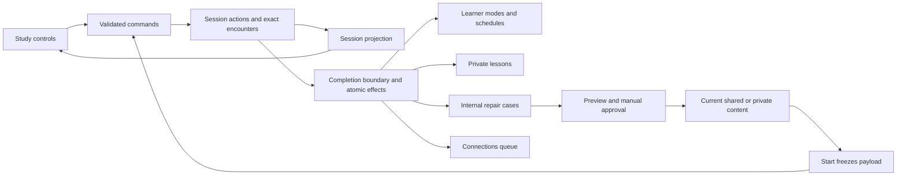

# Vocabulary learning implementation

This guide describes how the Mandarin vocabulary runtime realizes the
[product contract](../SPECS/vocabulary-learning.md) and
[architecture contract](../SPECS/vocabulary-architecture.md). It owns persistence,
selection, session execution, background preparation, and compatibility mechanisms.
Its implementation policies and measured limits describe current code.

For presentation and input behavior, use [Vocabulary study UI](implementation/vocabulary-ui.md).
For model-call stages and publication fences, use the
[content-improvement pipeline](implementation/vocabulary-content-improvement.md).
The [operator workflow](operator-panel.md#content-improvement-workflow) explains
review and application; the [migration guide](ops/schema-migrations.md#adaptive-vocabulary-cutover)
owns cutover procedures. The [first delivery plan](../notes/active/2026-10-16-vocabulary-first-deliverable-plan.md)
retains design rationale and original conversion scope.

**Reactions** are learner input about exercises: helpfulness ratings, dissatisfaction,
and comments. **Feedback** is the app's read-only teaching response to the learner.
Improvement assesses reactions as evidence, including concerns beyond its stated
quality principles. It can reject mistaken claims or requested remedies, and a
personal preference can justify another option without making the original bad.

Application helpers and model inputs use reaction terminology. Protocol v1 keeps
the historical `feedback` action/command and payload field, the `feedback` and
`effectiveFeedback` fields in frozen encounter evidence, and the `learner_feedback`
storage table. These compatibility spellings preserve log replay and retry
identity; they represent reactions. The separate `learner_feedback` job and
`/api/vocabulary/feedback` routes produce and expose app-generated feedback.

## One study write path



`server/vocabulary/study.ts` freezes ready material at Start and turns trusted commands
into ordered actions. `src/domain/vocabulary-session.ts` derives the live state
and final report. `server/db/vocabulary-sessions.ts` enforces ownership, retry
identity, snapshots, completion fencing, and atomic learning effects. HTTP clients
cannot submit their own grades, arbitrary encounter snapshots, or learner IDs.

`useVocabularyStudy` retains its controller at the app level across navigation.
A volatile ordered queue sends interactions incrementally while reveal content
is visible. Failed work keeps the same client ID for retry; Next and finalization
wait for outstanding saves. Pending/failed completion is recoverable, while active
session restoration after reload is unsupported. Cancellation and resume form a
single frontend transition so an automatic staging effect cannot race them.

## Retained session payload and hot-path work

The immutable `vocabulary_sessions.context_json` includes the versioned payload:
lexical facts, all mode-dependent exercise pools for admitted words, teaching and
priming material, selected pure cues, and complete encounter templates with
answer and reveal facts. The player selects dynamically within those pools as
the learner answers, skips, changes modes, requests More or undoes an action.
Teaching recognition rotates examples within its retained source. Publication,
edits, retirement, deactivation and external skill or proxy changes affect
subsequent sessions; admission to a new session does not guarantee an exercise
will be shown. Account and private-content access checks remain live. The current
card's personal notes remain a separate indexed learner lookup.

A connection-scoped cache holds at most 64 session runtimes, keyed by learner
and session. SQLite remains authoritative. Every access probes session ownership,
status and the latest indexed action sequence/identity. A mismatch, eviction or
new connection hydrates the immutable context and log once. Including action
identity detects rolled-back writes replaced at the same sequence. Cached values
are frozen so callers cannot mutate durable authority through shared references.

Ordinary appends validate the served version/access and response, write the log
and related evidence transactionally, then advance the projection using only new
actions. The next exercise is selected from the payload. Responses omit the
unserved repertoire. Existing sessions without a payload cannot continue study;
their evidence and completion records remain readable. The payload format was introduced without a schema migration. Compatibility is
determined by payload presence; an older active session without one cannot resume.

This focused implementation still copies and scans in-memory session evidence
and returns full action/encounter history. Undo and completion replay the log;
a cold cache also replays once. These costs grow with session length. It removes
live content discovery and repeated database history reads, without claiming
constant total work for an indefinitely long session.

A local synthetic benchmark (one word, repeated Next, in-memory SQLite, five
samples per checkpoint) measured the retained limits below. This excludes HTTP,
authentication, disk latency and hosted contention; it is not a production SLA.

| Encounters / actions | Median Next | Median JSON serialization | Response size |
| --- | --- | --- | --- |
| 15 / 29 | 0.41 ms | 0.15 ms | 30 KB |
| 105 / 209 | 0.85 ms | 1.10 ms | 197 KB |
| 505 / 1009 | 1.42 ms | 5.21 ms | 940 KB |

Run `RUN_SESSION_BENCHMARK=1 node --import tsx --test --test-name-pattern='measure retained-session' tests/vocabulary-study.test.ts`
to repeat the experiment. Regression tests also inspect SQL to ensure warm
progression does not reload context/history or query live content pools, rather
than relying on timing thresholds that vary by machine.

See the [state ownership](diagrams/vocabulary-session-state.svg),
[transition work](diagrams/vocabulary-session-transitions.svg), and
[content improvement](diagrams/vocabulary-session-improvement.svg) diagrams.

## Content identity and eligibility

`vocabulary-content.ts` owns complete current content and immutable full history,
including initial and current versions. Update preserves identity; replacement
creates a new identity and retires the predecessor atomically. Expected versions
reject stale changes. Session composition captures authored versions and current
identity-level sense mappings. Later serving uses that retained material.

`content_words` describes targets and contextual relationships. Accepted-answer
membership is separate; an answer word must also have a content relationship.
General selectors exclude teaching. Maintain prefers current curated versions;
a shared dictionary baseline is an explicit fallback when curated material is
unavailable, not a claim of curation. Its learner-independent identity is reused
across learners. Migrated legacy identities retain their original controls;
composition excludes duplicate stock fallback copies. Eligible authored word-specific
production excludes previously stored dictionary baselines from the composed
repertoire. Sense mapping and curation changes emit
transactional retained events.

`src/domain/production-proxy.ts` owns the shared proxy decision and the usable
targeted-cue exception. Both the legacy composer and vocabulary runtime invoke
that policy. Their adapters read different authoritative storage:
`server/db/pure-cues.ts` reads legacy publications, while
`server/vocabulary/production-coverage.ts` reads accepted-answer membership and
the current vocabulary targeted repertoire.
`review-selection.ts` applies it before objective ranking and session capacity;
`study.ts` also filters definition fallback when composing Practice or Maintain pools,
including baselines already stored as private content. A usable owned targeted
exercise remains eligible. Explicit prompt edits and replacements record authored
prompt provenance while retaining the dictionary source as ancestry; editing only
an explanation leaves fallback classification intact. This also applies to
single-improvement proposals that create an additional cue from a fallback.
The predicate reads current vocabulary content rather
than the retained legacy publication tables, so subsequent repairs affect it.
Pure-cue due dates and learner deactivation do not change shared proxy coverage.
The [selection contract](../SPECS/vocabulary-learning.md#learner-mode-and-selection)
defines its boundaries with suppression, recognition and Solidify.

## Learner state and composition

`vocabulary-learners.ts` owns word modes, stash membership, dismissal, and separate
scheduler records. Mode changes preserve schedules. Recognition and contextual
selection retain their independent skill scheduling. Pure cues retain independent
learner schedules. Learner reactions do not implicitly deactivate an exercise.

Session composition reads existing learner-owned production skill enablement and
relevance records. At composition, production relevance `suppressed` excludes
individual-word production, including authored exercises, despite the legacy command name
`suppress_definition_production`. This is the intended skill-level meaning in
the vocabulary runtime. Mode changes, refresh and content repair leave that flag
intact. Pure-cue adoption and selection require at least one unsuppressed eligible
member; other suppressed members remain accepted answers. Recognition and contrast
use their own eligibility. The initial vocabulary UI and operator proposals do
not expose suppression or its reversal.

Solidify freezes its enabled recognition/production directions in `solidifySkills`
when the session starts. Daily coverage requires that subset, and ordinary warmup
still uses the introduction. A single enabled direction can cover the day but
cannot qualify for automatic graduation; both disabled excludes the word from
admission. A later skill-setting change affects subsequent sessions, not the
active session's frozen directions or coverage requirements; see the
[retained payload](#retained-session-payload-and-hot-path-work).

Initial policies are deliberately simple: ordinary Solidify covering is daily,
Practice uses spacing and shortens after a lapse, Maintain receives temporary
refresh after a lapse. Three consecutive clean covered Solidify sessions recommend
Practice; initial teaching does not count. Clean means successful general recognition
and production recall, coverage, and no effective rejection. The recommendation is shown in the
summary and applied at finalization unless the learner chooses otherwise. Covered
Solidify work becomes eligible on the next UTC day; extra practice within the same
session does not add another qualifying session. Uncovered work remains eligible.

An explicit Solidify choice, including choosing the current mode, persists
`learner_words.automatic_promotion_paused`. That word stays in Solidify until the
learner manually changes mode. Choosing another mode clears the pause. Session
choices take effect at finalization and follow ordinary Undo/cancellation; direct
word-panel choices apply immediately. The pause is frozen into session context,
and a newer external choice takes precedence when an older session closes.
Automatic Maintain is disabled. Refresh gives a bounded three-day priority window.
These are versioned policy choices, not claims of measured mastery.

The reducer implements these requirements from the product contract:

| Mode | Ordinary completion |
| --- | --- |
| Unstudied / teaching | Introduction and three consecutive successes per skill, recognition and production. A rejection resets only that skill's streak. |
| Solidify | Warmup, then successful recognition and production. |
| Practice / Maintain | One selected due skill per word; first success completes it, or three consecutive successes after a rejection. |

Explicit Enough also covers learned words without granting successful recall.
Teaching, recognition, production and Solidify
warmups rotate across words: the selector aims for two intervening presentations
before returning to a word, shortening the gap when fewer candidates remain.
New-word admission still respects the introduction composition settings; finishing
only selects already admitted work. The effective presentation log determines
rotation. The frozen context records each review word's `selectedSkill` and a
`reviewOrder` containing word and independent pure-cue entries. Pure cues interleave
with word exercises and use the same first-success / three-after-rejection rule;
their coverage never becomes word credit.

Composition retains the shared 1,000-item cap and 50/30/20 review/learning/new
bucket weights, mapped to Practice/Maintain, Solidify, and Unstudied. Unused bucket
capacity is redistributed. Review selects the most urgent eligible skill for each
word and updates only the exercised skill at closure. Completed review assessment
also applies the shared six-hour word recency guard, preventing another due skill
from immediately bringing that word back. Production lapses shorten its interval
to six hours; Maintain retains its temporary-refresh policy.

### Preview and admission

Home previews the same final admission plan as Start, counting each selected word
objective and independent pure cue once, rather than counting repeated exercises
or dictionary entries. The ready count remains visible in the compact Connections
view. Initial loading and settings changes refresh the preview; background
preparation polling retains the last usable count. Zero ready items offer Check
again. Preview and Start reconcile the stable teaching reserve through the
shared, idempotent preparation queue. Planning then reads readiness and existing cue schedules without creating sessions,
enrolling words, establishing senses, or adopting/updating cue schedules. Start
reuses the preview's sampling seed while creating its own fresh session identity;
intervening readiness, schedule, or settings changes can still change admission.

Home's active-time section shows Today and 3-/7-day averages from consecutive UTC
daily totals, including zero-activity days. Unmeasured sessions are disclosed and
never filled with estimated durations.

## Session actions and completion

The study controller flushes queued work and retrieves any pending or failed
prior completion before Start. It closes that completion before requesting a
new session. Failed closure leaves Start retryable and prevents the new session
request; this ordering is owned by `useVocabularyStudy`, not independently
performed by the server's session-creation function.

Recognition records learner self-assessment. Typed production compares normalized
input with the retained accepted-answer forms. Contrast validates a selected
served word identity against the retained correct-choice criteria. The server
verifies the outcome against the served assessment before retaining the response.

Before the answer is revealed, Try another way logs an `exercise_exclude` alongside the skipped encounter and
next presentation. Its content identity is excluded for the session, across
versions and manual revisits; Undo reverses the transition. Teaching and recognition
do not offer this control. Correct results offer continuation rather than Skip.
After a wrong answer, ordinary continuation rotates onward and leaves the failed
exercise available for a later retry; it does not exclude the exercise. Ordinary
Skip retains the possibility of a later retry.
When a learned word has no eligible remaining exercise, it is left unfinished
without new coverage; recognition is not repeated as a substitute for production.
Recognition self-ratings advance after saving, including successful save retries.
Production retains the answer reveal before continuation.

Selecting a covered word sends `requeue`, which records the existing `word_more`
transition without serving another exercise. The current encounter and input
remain in place; ordinary selection later interleaves the reopened work. Queued
words have disabled queue actions. The same command identity retries once;
a second queue request for already open work returns a conflict. Undo reverses
the reopening while retaining coverage evidence. Extra practice remains open
until the learner ends it with “I’m satisfied” or leaves it. Finish for now waits
for that explicitly queued work, including requests made while finishing;
Finish immediately can end the session before extra practice is finished.

Extra practice retains prior coverage and rejoins the ordinary queue when finished. Summary
mode edits cancel and restage pending completion; closed-session edits are new
learner commands. Unstudied defers fresh teaching to the next session.

The controller closes the pending revision at its 15-second deadline and
returns to Home after successful closure. “Keep summary open” and summary edits
retain the report while finalization proceeds. Cancellation and Undo operate
only within the pending window; keeping the report open does not extend it.
Save failures preserve the report and expose retry. The controller records
active study duration across visibility and focus changes, freezing that value
at the acknowledged completion boundary.

## Background work and operator repair

This section describes worker execution and preparation. The
[operator workflow](operator-panel.md#content-improvement-workflow) owns review
controls; the [provider pipeline](implementation/vocabulary-content-improvement.md)
explains repair stages.

### Dispatch and model routing

`processing-worker.ts` closes due completions and ingests evidence even when
provider work is disabled. Learner-feedback and exercise-improvement jobs have
separate claims and outcomes. Teaching issues stay manual. Failed calls and
expired unknown outcomes require explicit retry, except for preparation dependencies
within their bounded automatic retry cycle; lease tokens fence late results.
Maintenance and disabled-learner checks protect dispatch and publication.

Individual reflection jobs select Luna, GLM, or Sol with equal probability,
regardless of how many encounters their evidence contains. The separate batched
policy retains GLM/Luna at 70/30 for up to ten items and Sol/GLM/Luna at 60/20/20
for larger bundles; vocabulary jobs do not currently batch unrelated cases. Selection is
retained across stages and retries. The spend guard restricts new routing to Luna
and rejects retries of disallowed arms rather than silently changing models.
This applies to learner feedback, improvements, and AI second opinions; practice
and sense authoring keep their independently configured model.

### Teaching reserve

`preparation-reserve.ts` maintains up to twice the configured daily new-word
limit (maximum 40), independent of the remaining intake today. It shares the
stash/diet admission planner, prefers existing members, and uses a stable reserve
seed. Preparation failure retains its slot; source, priority, quota and learner
lifecycle changes can change membership. The existing reserve tables and settings
triggers remain authoritative. Vocabulary add, enrollment, stash, dismissal, mode
and closure writes request reconciliation; the periodic word-preparation runtime
reconciles pending learners. Preview and Start also reconcile before composition.
Only bootstrap and teaching jobs are queued for reserve candidates.

### Preparation compatibility

Migration `0057_preparation_compatibility` records an explicit preparation epoch
on the shared preparation pointer; existing rows start at zero, with no eager
queueing. The current boundary is epoch 1. Prompt or model revisions alone do not change
this compatibility epoch or invalidate prepared teaching. Reserve reconciliation clears old
source/package pointers and requeues bounded bootstrap/teaching work while
retaining artifact and attempt history. Active provider work defers refresh;
paused failures retain their operator retry boundary. Repeated reconciliation
does not reset the current cycle's failure budget. Imported teaching admission
requires the current source/package at a compatible epoch. Native vocabulary
introductions already use the current content contract.

Runtime publication preserves established or partial sense inventories and their
identities. Refreshed source uses have unresolved mappings until explicitly
mapped; no text-based identity merge is inferred. Cold words can establish their
initial inventory. Historical reviewed words are not scanned or regenerated;
existing material remains usable and shared improvements can enter later sessions.
Applying migration `0057_preparation_compatibility` requires the stopped-writer
procedure. Later code-only changes are classified separately by the release runbook.

### Post-teaching practice preparation

Successful session closure queues general practice for completed teaching in the
same transaction as learning effects. Undo before closure and failed closure
create no practice demand. Queueing does not require configured credentials;
provider dispatch retains its configuration and hosted-control gates. The
vocabulary preparation worker consumes the durable practice queue without
scanning active session JSON. Live Next, command and read routes never wake
workers. Preview, Start, refresh and closure can schedule a wake after returning
the response. Publication supplies future session composition.
The shared teaching pipeline generates the introduction first, then exercises
conditioned on that delivered material. A failed companion call preserves the
successful introduction. No session waits for either workflow.

A wholly unprepared word therefore uses four authoring calls: lexical bootstrap,
introduction, teaching exercises, and the independent general-practice pool.
The first three establish a ready teaching repertoire; general practice is
prepared after committed teaching completion. These are shared artifacts, not
per-learner or per-session calls. The starting general v4 and teaching-exercise v2
briefs come from the retained [editorial trials](implementation/vocabulary-prompt-handoff.md).
Existing artifacts are reused; retry creates additional attributable attempts.

### Preparation retries

Failed practice preparation appears in operator review with its retained invocation and
attempt count after its automatic retry cycle is exhausted. Practice and sense
preparation make up to three attempts per cycle, retrying after 30 and 60 seconds.
Operator retry starts a new cycle while retaining earlier attempt provenance.
A provider-wide outage pauses new practice-worker dispatch for 60 seconds using
the shared preparation error classification. Per-job retry deadlines and budgets
remain intact; invalid generated content stays an item-local failure. Calls already
in flight may still publish if their ordinary control and lease checks pass.
Retries do not bypass provider-work or maintenance controls.

## Feedback and scheduling compensation

Automatic scheduling compensation is independent of content application. The
initial policy compensates general production and independent pure-cue scheduling,
delaying current eligibility by at most 24 hours when every effective rejection
within that scope was judged unfair. Word-scoped compensation also requires that
the word was covered in the original finalized session. Uncovered words retain
their scheduling eligibility, learner feedback, and content improvement work,
even if a later session covers the word. Recognition and contrast receive no
provider lessons, content-improvement calls, or automatic compensation. Their
full evidence remains in the session log, and their encounters are excluded
from mixed-word feedback aggregation. Mixed genuine/unfair production
mistakes retain the conservative schedule; unrelated skills do not veto production
compensation. Explicit mode and active learner-requested refresh choices are not
reversed; receipts prevent duplicate adjustment.

## Events and model provenance

`emitBackendEvent` accepts an event name and JSON data with optional identity,
actor, session, and causal context. Domain-change evidence is written inside the
same transaction as its effect. Retained rich records join through content,
encounter, invocation, case, proposal, and application identities.

The common provider transport retains exact request/response evidence, prompt
and schema metadata, settings, workflow attribution, timing, usage, and cost.
Service calls have explicit service ownership and optional source learner context.
Content/sense links point to the exact versions consumed or produced. Human edits
and imports retain their own origins. Missing legacy provenance stays unknown;
credentials and transport headers are not retained.

## Cutover compatibility

Migrations 0039–0048 introduce content/provenance, learner state, session evidence,
legacy import, internal reflection, authoring links, integrity guards, dismissal,
and Connections sources. Migrations 0049–0055 add sense readiness, improvement
admission, pure-cue promotion, promotion controls, second opinions, provider
retry/routing state, and feedback dismissal. This vocabulary cutover sequence follows migrations 0037/0038. The migration runner refuses to copy learner state while
legacy completion or authorized reflection effects remain pending. Settle them
under the previous runtime; the failed migration rolls back. Preserve other old
records as history. Mandarin legacy session/proposal, introduction open/complete,
and content-editor write routes return a cutover conflict. Legacy session-payload
reads are also retired because they composed and reserved work. Historical editor
reads remain available; legacy application workers do not resume those writes.

The conversion makes no model calls. Existing learning → Solidify, review →
Practice; stash, scheduling values, scoped content, teaching history, and explicit
deactivations are retained. Unsupported empty answer spaces remain in their
original tables with an exclusion record. Sense associations can be enriched
incrementally. Import identity and source mappings make repeats safe without
overwriting subsequent authored improvements.

Applying the vocabulary cutover migrations requires the
[offline migration procedure](ops/schema-migrations.md#adaptive-vocabulary-cutover).
Subsequent releases are classified against their own pending schema and data
changes; the cutover does not make every later release schema-changing.
Migration and deployment status require operation-specific evidence.

## Contributor verification

For a disposable, provider-disabled local fixture:

```sh
node --import tsx scripts/prepare-vocabulary-fixtures.ts --data-dir=/absolute/new/directory
```

The directory must not exist. It contains its own database, seed, and manifest.
The full fixture admits 12 words through normal session composition:

| Mode | Words | Starting scenario |
| --- | --- | --- |
| Teach | 藤椒、泡沫 | Prepared teaching, not yet completed |
| Solidify | 不堪 | 0 clean sessions |
| Solidify | 石沉大海 | 1 clean session |
| Solidify | 为所欲为 | 2 clean sessions; clean coverage recommends Practice |
| Solidify | 花卉 | 3 clean sessions; a previous-day explicit Solidify choice prevents automatic promotion |
| Practice | 报备、鼓舞、百分点、部署、馋、阐述 | Due today, with authored general exercises |

The five added Practice words and 花卉 each have three general exercises for
trying another way. Incidental seed words are scheduled outside this walkthrough.
The fixture records 花卉's synthetic prior session through actual finalization:
it first qualified for Practice, then the learner chose Solidify. The manifest
retains that session/completion and the expected progression for each Solidify word.
Provider work stays disabled; closure and persistence still run normally. A fresh
directory restores the starting scenarios without overwriting an earlier run.
For interactive UI review, default to a fresh fixture when bringing it back for
a new review round; reopening the previous run can leave only a few due items.
Preserve an in-progress run only when requested. Verify the Home preview shows
all 12 study items before handing the fixture back.

Start the backend with that directory, the printed learner, and seed; point Vite's
`VITE_API_BASE` at that API. The presentation fixture is
`/tests/browser/vocabulary-ui.html`, the operator fixture is
`/tests/browser/vocabulary-operator.html`, and the real-hook cancellation regression
fixture is `/tests/browser/vocabulary-controller.html` (also `?mode=undo`).
The prompt experiment harness retains offline inputs, outputs, variants, and
review notes; see [its handoff](implementation/vocabulary-prompt-handoff.md).
