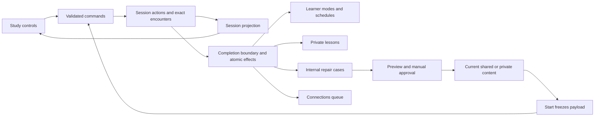

# Vocabulary learning implementation

This guide describes how the Mandarin vocabulary runtime realizes the
[product contract](../SPECS/vocabulary-learning.md) and
[architecture contract](../SPECS/vocabulary-architecture.md). It owns persistence,
selection, session execution, background preparation, and compatibility mechanisms.
Its implementation policies and measured limits describe current code.

For presentation and input behavior, use [Vocabulary study UI](implementation/vocabulary-ui.md).
For model-call stages and publication fences, use the
[content-improvement pipeline](implementation/vocabulary-content-improvement.md).
The [operator workflow](operator-panel.md#content-improvement-workflow) explains
review and application; the [migration guide](ops/schema-migrations.md#adaptive-vocabulary-cutover)
owns cutover procedures. The [first delivery plan](../notes/active/2026-10-16-vocabulary-first-deliverable-plan.md)
retains design rationale and original conversion scope.

**Reactions** are learner input about exercises: helpfulness ratings, dissatisfaction,
and comments. **Feedback** is the app's read-only teaching response to the learner.
Improvement assesses reactions as evidence, including concerns beyond its stated
quality principles. It can reject mistaken claims or requested remedies, and a
personal preference can justify another option without making the original bad.

Application helpers and model inputs use reaction terminology. Protocol v1 keeps
the historical `feedback` action/command and payload field, the `feedback` and
`effectiveFeedback` fields in frozen encounter evidence, and the `learner_feedback`
storage table. These compatibility spellings preserve log replay and retry
identity; they represent reactions. The separate `learner_feedback` job and
`/api/vocabulary/feedback` routes produce and expose app-generated feedback.

## One study write path



`server/vocabulary/study.ts` freezes ready material at Start and turns trusted commands
into ordered actions. `src/domain/vocabulary-session.ts` derives the live state
and final report. `server/db/vocabulary-sessions.ts` enforces ownership, retry
identity, snapshots, completion fencing, and atomic learning effects. HTTP clients
cannot submit their own grades, arbitrary encounter snapshots, or learner IDs.

`useVocabularyStudy` retains its controller at the app level across navigation.
A volatile ordered queue sends interactions incrementally while reveal content
is visible. Failed work keeps the same client ID for retry; Next and finalization
wait for outstanding saves. Pending/failed completion is recoverable, while active
session restoration after reload is unsupported. Cancellation and resume form a
single frontend transition so an automatic staging effect cannot race them.

## Retained session payload and hot-path work

The immutable `vocabulary_sessions.context_json` includes the versioned payload:
lexical facts, reachable exercise pools for admitted words, selected pure cues,
and complete encounter templates with answer and reveal facts. Unstudied words
retain teaching plus Solidify general material for More after teaching completion.
Solidify retains its priming introduction and general pool; Practice and Maintain
retain their own general pools. Automatic graduation applies at closure. The
player selects dynamically within those pools as the learner answers, skips,
requests More or undoes an action.
Teaching recognition rotates examples within its retained source. Publication,
edits, retirement, deactivation and external skill or proxy changes affect
subsequent sessions; admission to a new session does not guarantee an exercise
will be shown. Account and private-content access checks remain live. The current
card's personal notes remain a separate indexed learner lookup.

Presentation validation compares accepted-answer forms with the retained content
version as sets of exact strings: order and duplicate entries do not change
membership. Grading criteria and source material must still match exactly. This
comparison preserves the frozen snapshot and its display order.

A connection-scoped cache holds at most 64 session runtimes, keyed by learner
and session. SQLite remains authoritative. Every access probes session ownership,
status and the latest indexed action sequence/identity. A mismatch, eviction or
new connection hydrates the immutable context and log once. Including action
identity detects rolled-back writes replaced at the same sequence. Cached values
are frozen so callers cannot mutate durable authority through shared references.

Ordinary appends validate the served version/access and response, write the log
and related evidence transactionally, then advance the projection using only new
actions. The next exercise is selected from the payload. Responses omit the
unserved repertoire. Existing sessions without a payload cannot continue study;
their evidence and completion records remain readable. The payload format was introduced without a schema migration. Compatibility is
determined by payload presence; an older active session without one cannot resume.

This focused implementation still copies and scans in-memory session evidence
and returns full action/encounter history. Undo and completion replay the log;
a cold cache also replays once. These costs grow with session length. It removes
live content discovery and repeated database history reads, without claiming
constant total work for an indefinitely long session.

A local synthetic benchmark (one word, repeated Next, in-memory SQLite, five
samples per checkpoint) measured the retained limits below. This excludes HTTP,
authentication, disk latency and hosted contention; it is not a production SLA.

| Encounters / actions | Median Next | Median JSON serialization | Response size |
| --- | --- | --- | --- |
| 15 / 29 | 0.41 ms | 0.15 ms | 30 KB |
| 105 / 209 | 0.85 ms | 1.10 ms | 197 KB |
| 505 / 1009 | 1.42 ms | 5.21 ms | 940 KB |

Run `RUN_SESSION_BENCHMARK=1 node --import tsx --test --test-name-pattern='measure retained-session' tests/vocabulary-study.test.ts`
to repeat the experiment. Regression tests also inspect SQL to ensure warm
progression does not reload context/history or query live content pools, rather
than relying on timing thresholds that vary by machine.

See the [state ownership](diagrams/vocabulary-session-state.svg),
[transition work](diagrams/vocabulary-session-transitions.svg), and
[content improvement](diagrams/vocabulary-session-improvement.svg) diagrams.

## Content identity and eligibility

`vocabulary-content.ts` owns complete current content and immutable full history,
including initial and current versions. Update preserves identity; replacement
creates a new identity and retires the predecessor atomically. Expected versions
reject stale changes. Session composition captures authored versions and current
identity-level sense mappings. Later serving uses that retained material.

`sense-readiness.ts` distinguishes an unestablished catalog from an established
catalog with zero active senses. The latter is a valid result and does not call
the inventory provider again. `sense-inventory-contract.ts` accepts an empty
`senses` array; readiness establishes the catalog and resolves unknown useful
defaults to `[]`. A nonempty inventory with no selected defaults instead retains
the operator-review recommendation.

`server/db/vocabulary-sense-eligibility.ts` supplies the shared empty-inventory
check that excludes those words from new session admission, ordinary and pure-cue accepted answers, and contrast choices.
It applies before capacity allocation and when retaining the session's content.
Stash membership, learner scheduling and historical content are not deleted.
Existing session payloads keep their pinned material. The learner interface has
no dedicated explanation or customization flow for this state.

`content_words` describes targets and contextual relationships. Accepted-answer
membership is separate; an answer word must also have a content relationship.
General selectors exclude teaching. Maintain prefers current curated versions;
a shared dictionary baseline is an explicit fallback when curated material is
unavailable, not a claim of curation. Its learner-independent identity is reused
across learners. Migrated legacy identities retain their original controls;
composition excludes duplicate stock fallback copies. Eligible authored word-specific
production excludes previously stored dictionary baselines from the composed
repertoire. Sense mapping and curation changes emit
transactional retained events.

`src/domain/production-proxy.ts` owns the shared proxy decision and the usable
targeted-cue exception. Both the legacy composer and vocabulary runtime invoke
that policy. Their adapters read different authoritative storage:
`server/db/pure-cues.ts` reads legacy publications, while
`server/vocabulary/production-coverage.ts` reads accepted-answer membership and
the current vocabulary targeted repertoire.
`review-selection.ts` applies it before objective ranking and session capacity;
`study.ts` also filters definition fallback when composing Practice or Maintain pools,
including baselines already stored as private content. A usable owned targeted
exercise remains eligible. Explicit prompt edits and replacements record authored
prompt provenance while retaining the dictionary source as ancestry; editing only
an explanation leaves fallback classification intact. This also applies to
single-improvement proposals that create an additional cue from a fallback.
The predicate reads current vocabulary content rather
than the retained legacy publication tables, so subsequent repairs affect it.
Pure-cue due dates and learner deactivation do not change shared proxy coverage.
The [selection contract](../SPECS/vocabulary-learning.md#learner-mode-and-selection)
defines its boundaries with suppression, recognition and Solidify.

## Learner state and composition

`vocabulary-learners.ts` owns word modes, stash membership, dismissal, and separate
scheduler records. Mode changes preserve schedules. Recognition and contextual
selection retain their independent skill scheduling. Pure cues retain independent
learner schedules. Learner reactions do not implicitly deactivate an exercise.

Practice/Maintain composition reads existing learner-owned production skill enablement and
relevance records. At composition, production relevance `suppressed` excludes
individual-word production, including authored exercises, despite the legacy command name
`suppress_definition_production`. This is the intended skill-level meaning in
the vocabulary runtime. Mode changes, refresh and content repair leave that flag
intact. Pure-cue adoption and selection require at least one unsuppressed eligible
member; other suppressed members remain accepted answers. Recognition and contrast
use their own eligibility. The initial vocabulary UI and operator proposals do
not expose suppression or its reversal.

New teaching and Solidify use fixed recognition and production directions, regardless
of review skill enablement or relevance. Solidify freezes both in `solidifySkills`
at session start; daily coverage and automatic graduation require both directions.
Content validity, reconciliation, and availability checks still apply. Familiar
priming uses retained introduction material in a
[separate reveal sequence](implementation/vocabulary-ui.md#introduction-and-warmup).
Previously retained sessions keep their recorded skill subset and coverage rules;
see the [retained payload](#retained-session-payload-and-hot-path-work).

Initial policies are deliberately simple: ordinary Solidify covering is daily,
Practice uses spacing and shortens after a lapse, Maintain receives temporary
refresh after a lapse. Three consecutive clean covered Solidify sessions recommend
Practice; initial teaching does not count. Clean means successful general recognition
and production recall, coverage, and no effective rejection. The recommendation is shown in the
summary and applied at finalization unless the learner chooses otherwise. Covered
Solidify work becomes eligible on the next UTC day; extra practice within the same
session does not add another qualifying session. Uncovered work remains eligible.

An explicit Solidify choice, including choosing the current mode, persists
`learner_words.automatic_promotion_paused`. That word stays in Solidify until the
learner manually changes mode. Choosing another mode clears the pause. Closed
summary and word-panel choices apply immediately to future sessions. The pause
is frozen into session context,
and a newer external choice takes precedence when an older session closes.
Automatic Maintain is disabled. Refresh gives a bounded three-day priority window.
These are versioned policy choices, not claims of measured mastery.

The reducer implements these requirements from the product contract:

| Mode | Ordinary completion |
| --- | --- |
| Unstudied / teaching | Introduction and three consecutive successes per skill, recognition and production. A rejection resets only that skill's streak. |
| Solidify | Warmup, then successful recognition and production. |
| Practice / Maintain | One selected due skill per word; first success completes it, or three consecutive successes after a rejection. |

Explicit Enough also covers learned words without granting successful recall.
Teaching, recognition, production and Solidify
warmups rotate across words: the selector aims for two intervening presentations
before returning to a word, shortening the gap when fewer candidates remain.
New-word admission still respects the introduction composition settings; finishing
only selects already admitted work. The effective presentation log determines
rotation. The frozen context records each review word's `selectedSkill` and a
`reviewOrder` containing word and independent pure-cue entries. Pure cues interleave
with word exercises and use the same first-success / three-after-rejection rule;
their coverage never becomes word credit. Pure-cue admission selects from schedule
metadata and current relationship eligibility, then hydrates the chosen cues during
composition. The session freezes their content before play begins.

Composition retains the shared 1,000-item cap and 50/30/20 review/learning/new
bucket weights, mapped to Practice/Maintain, Solidify, and Unstudied. Unused bucket
capacity is redistributed. Review selects the most urgent eligible skill for each
word and updates only the exercised skill at closure. Its schedule query establishes
skill enablement and relevance, and due filtering precedes content-dependent
eligibility checks. Solidify checks its recall directions independently.
Completed review assessment
also applies the shared six-hour word recency guard, preventing another due skill
from immediately bringing that word back. Production lapses shorten its interval
to six hours; Maintain retains its temporary-refresh policy.

Clean Practice/Maintain word-skill recall uses
`(interval + max(0, elapsed - interval) / 2) × ease`, rounded up to hours before
the existing ±1-hour jitter. A four-day interval recalled after twelve days at
2.5 ease therefore earns about twenty days. Elapsed time runs from that skill's
stored last-study timestamp to its first effective response in the session;
help-used responses earn no extra elapsed credit. Failures still reset to six
hours, and no-response coverage grants no recall credit. The policy applies to
production, recognition and contextual selection, including Maintain review,
but not Solidify or independent pure cues.

Session closure sets a word-skill's scheduling clock from the latest effective
response, preserving a newer stored timestamp when an older session closes.
[Unfair-lapse compensation](#feedback-and-scheduling-compensation) can restore
the production clock independently of the attempt log. Older schedules can
still contain finalization timestamps. Due dates and the shared recency guard
use finalization time, so delayed finalization and retries cannot increase the
elapsed retention credit.

### Preview and admission

Home previews the same final admission plan as Start, counting each selected word
objective and independent pure cue once, rather than counting repeated exercises
or dictionary entries. The ready count remains visible in the compact Connections
view. Initial loading and settings changes refresh the preview; background
preparation polling retains the last usable count. Zero ready items offer Check
again. Preview and Start consume reserve readiness hints and existing cue schedules without reconciling or waking preparation. Preview does not create sessions,
enrolling words, establishing senses, or adopting/updating cue schedules. Start
reuses the preview's sampling seed while creating its own fresh session identity;
intervening readiness, schedule, or settings changes can still change admission.

Home's active-time section shows Today and 3-/7-day averages from consecutive UTC
daily totals, including zero-activity days. Unmeasured sessions are disclosed and
never filled with estimated durations.

### Timed daily practice (prototype)

The `timed_sessions` service control, on by default, makes Start use the timed
paradigm from the [iterator prototype note](../notes/active/2026-11-11-timed-session-iterator-prototype.md).
A session keeps the paradigm it started under: Start freezes a `timed` context with
the local study day (04:00 boundary), the learner's `daily_study_minutes` (10, 20 or
30; default 20, recorded as `default` or `chosen`), the day's earlier active time,
the day active time at which this session wraps up, pressing keys, and each admitted
item's classic due date and prior-lapse flag. That context stays server-side; the
client receives only `timed` state (wrap-up, Study a little more, active time, note).

Due rules are unchanged; timed admission orders held items that were passed over on
three separate days (`learner_timed_skip_counts`) ahead of ordinary due work before
the shared cap applies. Selection treats Solidify words, any started item still owed
work (teaching begun, a missed review or pure cue) and those passed-over held items as
pressing. While any is still available, a not-yet-started new word does not begin.
Each appearance rests an item for a seeded random 2–5 cards. Seven picks in ten choose
at random among rested pressing items (`server/vocabulary/timed-selection.ts`); the
rest, and any pick with no rested pressing item, use the 50/30/20 draw over rested
non-pressing items. If nothing is rested, the item that has waited longest is served.
Introduction order and spacing settings do not apply and the settings panel hides
them. Admitted new words that never start remain enrolled, hidden Unstudied records
and stay eligible for later admission.

Each Next carries the client's active time, accepted within wall-clock bounds and
never moving backward. When the day's active time reaches the threshold, Next
records `finish_for_now` with `source: "budget"`; open work finishes and nothing new
begins. Replay reads that action and never recomputes the client clock. After a
budget wrap-up, the summary offers Study a little more: `studyMore` records `resume`
with a new threshold five minutes of active time ahead. A fresh Start into a spent
day also runs at least five minutes. Timed sessions offer no manual finish,
wrapping-up banner, remaining count or Home item count.

Closure clears the skip count of every started item and adds at most one passed-over
day to each due held item that went unstarted, including due words the cap kept out
of the pool and admitted pure cues. It fills `vocabulary_timed_session_records`:
session and day active time, extensions, whether the budget ended the session,
whether the new-word gate held, new words started, unstarted pressing keys and, per
served item, its class, classic due date, prior lapse and outcome. The summary's
optional line is saved to that record through its own endpoint and is never read by
selection. Abandoned sessions keep their last accepted active time in the day but
never close, so they add no skip counts.

## Session actions and completion

During active wrap-up, “Complete everything due” records `resume` to return the
projection from `finishing` to `active`. The current encounter and prior progress
are retained; ordinary selection can serve unstarted words and pure cues from
the frozen composition. No new composition or learning effects are created by
this choice. Undo returns to wrap-up. If no eligible work remains, ordinary Next
reaches completion. The same action also serves summary cancellation, behind
the existing pending-revision and durable-closure fences.

The study controller flushes queued work and retrieves any pending or failed
prior completion before Start. It closes that completion before requesting a
new session. Failed closure leaves Start retryable and prevents the new session
request; this ordering is owned by `useVocabularyStudy`, not independently
performed by the server's session-creation function.

Recognition records learner self-assessment. Typed production compares normalized
input with the retained accepted-answer forms. When that comparison accepts the
written form, the learner can mark the attempt wrong before it is saved. The
server retains the matching text, a rejected outcome, and that pronunciation
self-assessment. A production self-assessment on any other written form is
rejected. Contrast validates a selected
served word identity against the retained correct-choice criteria. The server
verifies the outcome against the served assessment before retaining the response.

Before the answer is revealed, Try another way logs an `exercise_exclude` alongside the skipped encounter and
next presentation. Its content identity is excluded for the session, across
versions and manual revisits; Undo reverses the transition. Teaching and recognition
do not offer this control. Correct results offer continuation rather than Skip.
After a wrong answer, ordinary continuation rotates onward and leaves the failed
exercise available for a later retry; it does not exclude the exercise. Ordinary
Skip retains the possibility of a later retry.
When a learned word has no eligible remaining exercise, it is left unfinished
without new coverage; recognition is not repeated as a substitute for production.
Recognition self-ratings advance after saving, including successful save retries.
Production retains the answer reveal before continuation.

Selecting a covered word sends `requeue`, which records the existing `word_more`
transition without serving another exercise. The current encounter and input
remain in place; ordinary selection later interleaves the reopened work. Queued
words have disabled queue actions. The same command identity retries once;
a second queue request for already open work returns a conflict. Undo reverses
the reopening while retaining coverage evidence. Extra practice remains open
until the learner ends it with “I’m satisfied” or leaves it. Finish for now waits
for that explicitly queued work, including requests made while finishing;
Finish immediately can end the session before extra practice is finished.

Extra practice retains prior coverage and rejoins the ordinary queue when finished.
Summary mode choices require successful closure and issue learner-state commands
for future sessions. The API rejects new session mode commands while retaining
historical mode actions for replay and acknowledged retries. Old payloads remain
usable; new payloads keep the same versioned shape with empty unreachable pools.
Unstudied defers fresh teaching to the next session.

The controller closes the pending revision at its 15-second deadline and
returns to Home after successful closure. “Keep summary open” retains the report
while finalization proceeds and makes post-closure choices available. Cancellation and Undo operate
only within the pending window; keeping the report open does not extend it.
Save failures preserve the report and expose retry. The controller records
active study duration across visibility and focus changes, freezing that value
at the acknowledged completion boundary.

## Background work and operator repair

This section describes worker execution and preparation. The
[operator workflow](operator-panel.md#content-improvement-workflow) owns review
controls; the [provider pipeline](implementation/vocabulary-content-improvement.md)
explains repair stages.

### Dispatch and model routing

Dispatch polling uses partial indexes for queued work in creation order and
running work by lease expiry. Completed and failed dispatch evidence remains
available for investigation without entering either active-work index. Queue
membership follows status, not session age, so old queued work and expired
claims remain discoverable after an interruption.

`processing-worker.ts` closes due completions and ingests evidence even when
provider work is disabled. Learner-feedback and exercise-improvement jobs have
separate claims and outcomes. Teaching issues stay manual. Failed calls and
expired unknown outcomes require explicit retry, except for sense-mapping availability
failures and preparation dependencies within their bounded automatic retry cycles; lease tokens fence late results.
Maintenance and disabled-learner checks protect dispatch and publication.

Individual learner-feedback jobs select GPT-6 Luna or Sol with equal probability.
Exercise-improvement jobs and second opinions select GPT-6 Luna, GLM, or Sol with
equal probability, regardless of how many encounters their evidence contains.
The separate batched policy retains GLM/Luna at 70/30 for up to ten items and
Sol/GLM/Luna at 60/20/20 for larger bundles; vocabulary jobs do not currently
batch unrelated cases. Selection is
retained across stages and retries for learner feedback, improvements, and AI
second opinions, except for sense mapping. Saved GLM learner-feedback routes use
GPT-6 Luna for subsequent calls while retaining the saved route and original
invocation evidence. Failed jobs still require explicit retry. Saved GPT-5.6 Luna
routes and reflection retries resolve to GPT-6 Luna for new calls; original run
metadata and pricing remain historical. Sense-inventory and general-practice
authoring also use GPT-6 Luna with high reasoning. The admission step that maps an authored
exercise to the existing sense inventory starts with OpenAI `gpt-6-luna` with high
reasoning, including operator reassessments. Mapping availability failures receive
three attempts, with 30- and 60-second backoff. After the third consecutive failure,
the next queued attempt switches to ZAI `glm-5.3-flash` with high reasoning and a
fresh three-attempt budget using the same backoff. Exhausting both providers requires
explicit operator retry, which starts a fresh Luna cycle. The durable mapping counter
is independent of job claims, sense-inventory preparation, and later authoring calls.
Each attempt runs through ordinary worker controls and lease fencing; expired unknown
outcomes require manual retry rather than automatically making another call.

Timeouts, recognized network failures, and HTTP 401/403/408/429/5xx responses qualify
as availability failures. Missing credentials and other HTTP errors (including
provider incompatibility) require manual retry. An assessment that returns invalid
JSON, truncation, or an explicit schema/domain validation failure is retried at most
three times, for four total attempts in that retry cycle. The durable budget spans
stages, is separate from availability retries, and resets on explicit operator retry.
Successful stages are retained; validation retries keep the selected model and run
under the usual source and lease fences. OpenAI requires
`OPENAI_API_KEY` and honors `OPENAI_BASE_URL`; fallback requires `ZAI_API_KEY`.
Cached mapping evidence includes the actual provider/model configuration in its
identity. A successful fallback mapping retains that identity when later authoring
needs a retry. Manual retry without successful mapping evidence starts a fresh
Luna cycle. Practice and sense-inventory authoring keep their independently
configured model and retry policies.

### Teaching reserve

`preparation-reserve.ts` maintains a normal buffer of twice the configured daily
new-word limit and retains explicit top choices even when that limit is zero.
Membership is capped at 40: newest top choices take precedence, followed by
stable fallback members. Priority writes admit top words immediately; maintenance
uses the stash/diet planner to replenish the remaining buffer. Eviction affects
membership only; generated material, outstanding jobs and failure evidence remain.

Migration `0070_background_teaching_reserve` adds nullable readiness/check
timestamps and schedules existing reserve owners for an initial check. It does
not infer readiness from old membership or create work for dormant nonmembers.
Vocabulary add, stash, dismissal, mode, settings, priority and closure writes
request reconciliation. Diet enrollment during Start does not request it.

The preparation runtime processes at most five pending learners and five overdue
reserve owners per 30-second tick, yielding before work and between learners.
Wakes share one in-flight pass. Audits are due five minutes after the oldest member
check; backlog can extend that delay. Empty or partial buffers retain durable
replenishment requests so future eligibility can be discovered without a visit.
Failed passes retain requests and rotate their audit priority. Disabled learners
and maintenance mode are excluded; shutdown stops workers and awaits maintenance.
Provider-disabled operation may still discover already-published usable content.

Usable content establishes readiness even if an older operational job is paused.
Otherwise failed members keep their slots, compatibility refresh respects leases
and retry budgets, and only reserve members request bootstrap/teaching work.
Established empty inventories are excluded. Periodic checks pick up publication
and manual edits without cross-learner cancellation or publication fanout.

Composition examines only ready reserve members, resolves newest usable coherent
teaching, and reuses that resolution in the frozen payload. Readiness is not a
version pin. Missing material is skipped; `vocabulary.reserve.stale_hint` records
one diagnostic per membership/readiness epoch rather than one per Home poll.
Operators can inspect the private diagnostic references read-only with:

```sh
node --import tsx scripts/inspect-reserve-diagnostics.ts --database=/absolute/path/app.db --limit=20
```

This command shows observation, learner, word and readiness timestamps; it neither
changes readiness nor retries work. Repeated distinct readiness epochs remain
separately diagnosable. These diagnostics are not reflection cases and do not
close or reset existing failure records.

### Preparation compatibility

Migration `0057_preparation_compatibility` records an explicit preparation epoch
on the shared preparation pointer; existing rows start at zero, with no eager
queueing. The current boundary is epoch 1. Prompt or model revisions alone do not change
this compatibility epoch or invalidate prepared teaching. Reserve reconciliation clears old
source/package pointers and requeues bounded bootstrap/teaching work while
retaining artifact and attempt history. Active provider work defers refresh;
paused failures retain their operator retry boundary. Repeated reconciliation
does not reset the current cycle's failure budget. Imported teaching admission
requires the current source/package at a compatible epoch. Native vocabulary
introductions already use the current content contract.

Runtime publication preserves established or partial sense inventories and their
identities. Refreshed source uses have unresolved mappings until explicitly
mapped; no text-based identity merge is inferred. Cold words can establish their
initial inventory. Historical reviewed words are not scanned or regenerated;
existing material remains usable and shared improvements can enter later sessions.
Applying migration `0057_preparation_compatibility` requires the stopped-writer
procedure. Later code-only changes are classified separately by the release runbook.

### Post-teaching practice preparation

This section describes ordinary learner-triggered demand. The
[repertoire preparation guide](implementation/repertoire-preparation.md)
explains the shared authoring machinery and operator-driven batch path, which
can prepare general repertoire independently of teaching completion.
Automatic first pools share the [Sol/Luna allocation](implementation/repertoire-preparation.md#automatic-authoring-model)
with first repertoire generation in reflection.

Successful session closure queues general practice for completed teaching in the
same transaction as learning effects. Undo before closure and failed closure
create no practice demand. Queueing does not require configured credentials;
provider dispatch retains its configuration and hosted-control gates. The
vocabulary preparation worker consumes the durable practice queue without
scanning active session JSON. Live Next, command and read routes never wake
workers. Preview, Start, refresh and closure can schedule a wake after returning
the response. Publication supplies future session composition.
The shared teaching pipeline generates the introduction first, then exercises
conditioned on that delivered material. A failed companion call preserves the
successful introduction. No session waits for either workflow.

For a wholly unprepared word with eligible selected senses, the pipeline uses
five authoring calls: inventory/default selection, example enrichment,
introduction, teaching exercises, and the independent general-practice pool.
The first four establish a ready teaching repertoire; general practice is
prepared after committed teaching completion. An empty inventory stops after
inventory generation. These are shared artifacts, not per-learner or per-session
calls. The general v5 and teaching-exercise v2
briefs come from the retained [editorial trials](implementation/vocabulary-prompt-handoff.md).
Existing artifacts are reused; retry creates additional attributable attempts.
General preparation creates no demand for a word with an established empty
inventory. A queued general-practice job settles as ready with a no-demand
diagnostic, without an authoring call. Content-improvement admission records
`no_senses_requested` before mapping or authoring when readiness returns that state. General authoring for
nonempty inventories trusts selected senses, including specialized learning needs.
Each new automatic exercise binds to one supplied sense so future serving policy
can include or exclude it. Unmapped legacy/manual content keeps its existing rules.
An empty authoring result preserves its valid invocation and recommendation,
publishes no exercises, and requires operator review without automatic retries.
An explicit operator retry can start another bounded cycle; selected coverage
is unchanged. The v5 prompt and empty-output schema change generation identity,
but each source keeps its existing automatic lifecycle: earlier ready pools,
queued/running work and exhausted budgets are retained. A prompt rollout does
not add a second pool or reset attempts. Unstarted work binds the current authoring
contract when claimed. Operator content review and explicit retries remain
separate from automatic preparation.

### Preparation retries

Failed practice preparation appears in operator review with its retained invocation and
attempt count after its automatic retry cycle is exhausted. Practice and sense
preparation make up to three attempts per cycle, retrying after 30 and 60 seconds.
Operator retry starts a new cycle while retaining earlier attempt provenance.
A provider-wide outage pauses new practice-worker dispatch for 60 seconds using
the shared preparation error classification. Per-job retry deadlines and budgets
remain intact; invalid generated content stays an item-local failure. Calls already
in flight may still publish if their ordinary control and lease checks pass.
Retries do not bypass provider-work or maintenance controls.

## Feedback and scheduling compensation

Learner lessons are queued for a word or an independent pure cue when its
effective general-production evidence contains a rejection or an effective
comment. The lesson stores that subject's general-production encounters and
keeps only each encounter's effective responses. An undone response remains in
the session projection and completion report, and it is absent from the lesson.
A later effective rejection or comment for the same subject still queues a
lesson from the retained evidence. Re-ingesting one closed completion returns
the original lesson cases. Exercise-improvement selection uses the same
effective general-production evidence: an undone response does not open an
improvement case and is omitted from its stored encounters, and
presentation-undone encounters are excluded. Teaching-review selection uses
the recorded encounters, including observations Undo retained.

Pronunciation-failure encounters, including their comments and reactions, do
not trigger post-session review and are excluded from model inputs even in
mixed cases for the same exercise or word. Internal case evidence retains them
so compensation cannot erase a genuine pronunciation lapse.

The learner-feedback judgment is the sole authority for scheduling compensation.
The decision covers all effective general-production rejections for one word
or independent pure cue in the originating completion. A genuine or pronunciation
lapse in that group blocks compensation. Recognition and contrast keep their
separate schedules. Uncovered work can still receive feedback and content review,
while compensation requires a lapse effect from the original closure.

Closure records the schedule immediately before and after its write in
`learner_state_effects`. Compensation looks up that receipt by completion,
learner, and subject. It restores interval, ease, the last-practised scheduling
clock, and the covered-session counter from the prior schedule. Pure cues also
recover their strong timestamp and maintenance success count. Subsequent study
can have changed these fields by judgment time. Its session actions and
completion reports remain intact, as do explicit mode and active requested
refresh. An automatic Maintain refresh is reversed if the originating lapse
created it and it is still the current refresh.

The scheduler records the end of the pause 24 hours after judgment, subject to
a later reset gate. For regular words, `postCompensationEarliestCheckAt` only gates production.
Ordinary due dates, interval eligibility, and skill ranking apply once it ends.
For independent pure cues, `postCompensationRecheckAt` schedules a recheck that
takes priority within the review bucket and bypasses routine strong-cue sampling.
A refresh preserves the pause, and
completion clears its timestamp only when covered production was assessed after
the break. Earlier responses still enter the session history. The judgment,
schedule write, and compensation receipt commit
together. The receipt records actual before and after state, the source effect
key when present, and an unavailable reason when reliable evidence is missing.
Pending judgments can use existing completion receipts. Completed judgments
replay their saved results, and historical receipts block repeat compensation.

## Events and model provenance

`emitBackendEvent` accepts an event name and JSON data with optional identity,
actor, session, and causal context. Domain-change evidence is written inside the
same transaction as its effect. Retained rich records join through content,
encounter, invocation, case, proposal, and application identities.

The common provider transport retains exact request/response evidence, prompt
and schema metadata, settings, workflow attribution, timing, usage, and cost.
Service calls have explicit service ownership and optional source learner context.
Content/sense links point to the exact versions consumed or produced. Human edits
and imports retain their own origins. Missing legacy provenance stays unknown;
credentials and transport headers are not retained.

## Cutover compatibility

Migrations 0039–0048 introduce content/provenance, learner state, session evidence,
legacy import, internal reflection, authoring links, integrity guards, dismissal,
and Connections sources. Migrations 0049–0055 add sense readiness, improvement
admission, pure-cue promotion, promotion controls, second opinions, provider
retry/routing state, and feedback dismissal. This vocabulary cutover sequence follows migrations 0037/0038. The migration runner refuses to copy learner state while
legacy completion or authorized reflection effects remain pending. Settle them
under the previous runtime; the failed migration rolls back. Preserve other old
records as history. Mandarin legacy session/proposal, introduction open/complete,
and content-editor write routes return a cutover conflict. Legacy session-payload
reads are also retired because they composed and reserved work. Historical editor
reads remain available; legacy application workers do not resume those writes.

The conversion makes no model calls. Existing learning → Solidify, review →
Practice; stash, scheduling values, scoped content, teaching history, and explicit
deactivations are retained. Unsupported empty answer spaces remain in their
original tables with an exclusion record. Sense associations can be enriched
incrementally. Import identity and source mappings make repeats safe without
overwriting subsequent authored improvements.

Applying the vocabulary cutover migrations requires the
[offline migration procedure](ops/schema-migrations.md#adaptive-vocabulary-cutover).
Subsequent releases are classified against their own pending schema and data
changes; the cutover does not make every later release schema-changing.
Migration and deployment status require operation-specific evidence.

## Contributor verification

For a disposable, provider-disabled local fixture:

```sh
node --import tsx scripts/prepare-vocabulary-fixtures.ts --data-dir=/absolute/new/directory
```

The directory must not exist. It contains its own database, seed, and manifest.
The full fixture admits 12 words through normal session composition:

| Mode | Words | Starting scenario |
| --- | --- | --- |
| Teach | 藤椒、泡沫 | Prepared teaching, not yet completed |
| Solidify | 不堪 | 0 clean sessions |
| Solidify | 石沉大海 | 1 clean session |
| Solidify | 为所欲为 | 2 clean sessions; clean coverage recommends Practice |
| Solidify | 花卉 | 3 clean sessions; a previous-day explicit Solidify choice prevents automatic promotion |
| Practice | 报备、鼓舞、百分点、部署、馋、阐述 | Due today, with authored general exercises |

The five added Practice words and 花卉 each have three general exercises for
trying another way. Incidental seed words are scheduled outside this walkthrough.
The fixture records 花卉's synthetic prior session through actual finalization:
it first qualified for Practice, then the learner chose Solidify. The manifest
retains that session/completion and the expected progression for each Solidify word.
Provider work stays disabled; closure and persistence still run normally. A fresh
directory restores the starting scenarios without overwriting an earlier run.
For interactive UI review, default to a fresh fixture when bringing it back for
a new review round; reopening the previous run can leave only a few due items.
Preserve an in-progress run only when requested. Verify the Home preview shows
all 12 study items before handing the fixture back.

Start the backend with that directory, the printed learner, and seed; point Vite's
`VITE_API_BASE` at that API. The presentation fixture is
`/tests/browser/vocabulary-ui.html`, the operator review fixture is
`/tests/browser/vocabulary-case-review.html`, and the real-hook cancellation regression
fixture is `/tests/browser/vocabulary-controller.html` (also `?mode=undo`).
The prompt experiment harness retains offline inputs, outputs, variants, and
review notes; see [its handoff](implementation/vocabulary-prompt-handoff.md).
