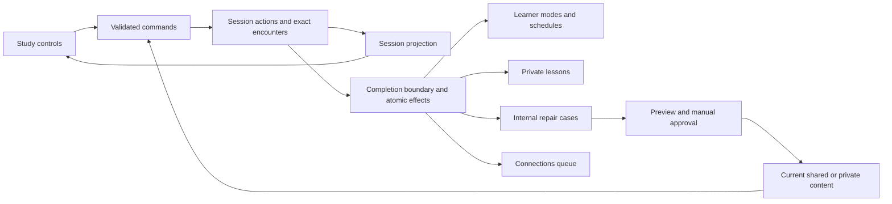

# Vocabulary learning implementation

This guide explains the Mandarin vocabulary runtime and its operational boundary.
The [feature contract](../SPECS/vocabulary-learning.md) owns learner-visible
promises; the [first delivery plan](../notes/active/2026-10-16-vocabulary-first-deliverable-plan.md)
records the product rationale and conversion scope.

## One study write path



`server/vocabulary/study.ts` selects ready material and turns trusted commands
into ordered actions. `src/domain/vocabulary-session.ts` derives the live state
and final report. `server/db/vocabulary-sessions.ts` enforces ownership, retry
identity, snapshots, completion fencing, and atomic learning effects. HTTP clients
cannot submit their own grades, arbitrary encounter snapshots, or learner IDs.

`useVocabularyStudy` retains its controller at the app level across navigation.
A volatile ordered queue sends interactions incrementally while reveal content
is visible. Failed work keeps the same client ID for retry; Next and finalization
wait for outstanding saves. Pending/failed completion is recoverable, while active
session restoration is outside this release. Cancellation and resume form a
single frontend transition so an automatic staging effect cannot race them.

## Content and learner persistence

`vocabulary-content.ts` owns complete current content and immutable full history,
including initial and current versions. Update preserves identity; replacement
creates a new identity and retires the predecessor atomically. Expected versions
reject stale changes. Teaching binds authored versions; fresh serving overlays
current identity-level sense mappings without rewriting historical encounters.

`content_words` describes targets and contextual relationships. Accepted-answer
membership is separate; an answer word must also have a content relationship.
General selectors exclude teaching. Maintain prefers current curated versions;
a direct dictionary baseline is an explicit fallback when curated material is
unavailable, not a claim of curation. Sense mapping and curation changes emit
transactional retained events.

`vocabulary-learners.ts` owns word modes, stash membership, dismissal, and separate
scheduler records. Mode changes preserve schedules. Recognition and contextual
selection retain their independent skill scheduling. Pure cues retain independent
learner schedules. Content feedback does not implicitly deactivate an exercise.

Initial policies are deliberately simple: ordinary Solidify covering is daily,
Practice uses spacing and shortens after a lapse, Maintain receives temporary
refresh after a lapse. Three clean covered Solidify sessions can recommend Practice;
automatic Maintain is disabled. Refresh gives a bounded three-day priority window.
These are versioned policy choices, not claims of measured mastery.

Within a session, one accepted general production response ordinarily covers a
word. Explicit Enough also covers; Leave stops without coverage. Extra practice
retains prior coverage and returns to the interrupted word when finished. Summary
mode edits cancel and restage pending completion; closed-session edits are new
learner commands. Unstudied defers fresh teaching to the next session.

## Background work and operator repair

`processing-worker.ts` closes due completions and ingests evidence even when
provider work is disabled. Learner-feedback and general-improvement jobs have
separate claims and outcomes. Teaching issues stay manual. Failed calls and
expired unknown outcomes require explicit retry; lease tokens fence late results.
Maintenance and disabled-learner checks protect dispatch and publication.

`preparation-worker.ts` prepares a general pool for actual study demand. It uses
ready source material and retained generation briefs, with service attribution.
The shared teaching pipeline generates the introduction first, then exercises
conditioned on that delivered material. A failed companion call preserves the
successful introduction. No session waits for either workflow.

A wholly unprepared word therefore uses four authoring calls: lexical bootstrap,
introduction, teaching exercises, and the independent general-practice pool.
The first three establish a ready teaching repertoire; general practice is
prepared separately for learned-word demand. These are shared artifacts, not
per-learner or per-session calls. The starting general v4 and teaching-exercise v2
briefs come from the retained [editorial trials](implementation/vocabulary-prompt-handoff.md).
Existing artifacts are reused; retry creates additional attributable attempts.

Learners read lessons in Feedback. Operators use `#operator-vocabulary` (also
linked from Content Bin), protected by the existing operator allowlist. Cases show
exact encountered material and current sources. Drafts expose update/replacement
strategy, complete content, scope, and rationale. Preview runs the real writers
under rollback; approval/application revalidate current bases. Teaching repairs
can update an exercise and explicitly bind its resulting version in the same
ordered proposal. Failed jobs and dispatches have explicit retry controls.
The initial model adapter drafts wording changes and additional variants of the
supplied exercise while preserving its accepted-answer membership. Operators can
edit the full authored draft, including its answer relationships, before preview.
Automatic proposals for new contrast clusters, expanded pure-cue membership, or
learner suppression are not supplied by this adapter.
Failed practice preparation also appears here with its retained invocation and
attempt count. Operator retry queues another attempt (up to three total); it does
not bypass provider-work or maintenance controls.

Automatic scheduling compensation is independent of content application. The
initial policy compensates general production and independent pure-cue scheduling,
delaying current eligibility by at most 24 hours when every effective rejection
within that scope was judged unfair. Recognition and contrast can produce lessons
but do not yet receive automatic compensation. Mixed genuine/unfair production
mistakes retain the conservative schedule; unrelated skills do not veto production
compensation. Explicit mode and active learner-requested refresh choices are not
reversed; receipts prevent duplicate adjustment.

## Events and model provenance

`emitBackendEvent` accepts an event name and JSON data with optional identity,
actor, session, and causal context. Domain-change evidence is written inside the
same transaction as its effect. Retained rich records join through content,
encounter, invocation, case, proposal, and application identities.

The common provider transport retains exact request/response evidence, prompt
and schema metadata, settings, workflow attribution, timing, usage, and cost.
Service calls have explicit service ownership and optional source learner context.
Content/sense links point to the exact versions consumed or produced. Human edits
and imports retain their own origins. Missing legacy provenance stays unknown;
credentials and transport headers are not retained.

## Conversion and local verification

Migrations 0037–0046 introduce content/provenance, learner state, session evidence,
legacy import, internal reflection, authoring links, integrity guards, dismissal,
and Connections sources. The migration runner refuses to copy learner state while
legacy completion or authorized reflection effects remain pending. Settle them
under the previous runtime; the failed migration rolls back. Preserve other old
records as history. Mandarin legacy session/proposal, introduction open/complete,
and content-editor write routes return a cutover conflict. Legacy session-payload
reads are also retired because they composed and reserved work. Historical editor
reads remain available; legacy application workers do not resume those writes.

The conversion makes no model calls. Existing learning → Solidify, review →
Practice; stash, scheduling values, scoped content, teaching history, and explicit
deactivations are retained. Unsupported empty answer spaces remain in their
original tables with an exclusion record. Sense associations can be enriched
incrementally. Import identity and source mappings make repeats safe without
overwriting subsequent authored improvements.

Use the [offline migration procedure](ops/schema-migrations.md). This release
cannot use app-only hosted upgrade. No hosted migration or deployment is implied
by passing tests or creating a review PR.

For a disposable, provider-disabled local fixture:

```sh
node --import tsx scripts/prepare-vocabulary-fixtures.ts --data-dir=/absolute/new/directory
```

The directory must not exist. It contains its own database, seed, and manifest.
Start the backend with that directory, the printed learner, and seed; point Vite's
`VITE_API_BASE` at that API. The presentation fixture is
`/tests/browser/vocabulary-ui.html`, the operator fixture is
`/tests/browser/vocabulary-operator.html`, and the real-hook cancellation regression
fixture is `/tests/browser/vocabulary-controller.html` (also `?mode=undo`).
The prompt experiment harness retains offline inputs, outputs, variants, and
review notes; see [its handoff](implementation/vocabulary-prompt-handoff.md).
