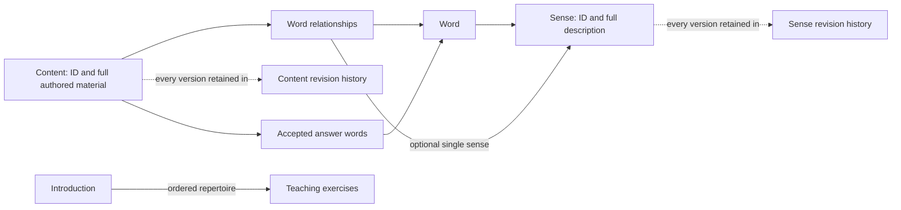
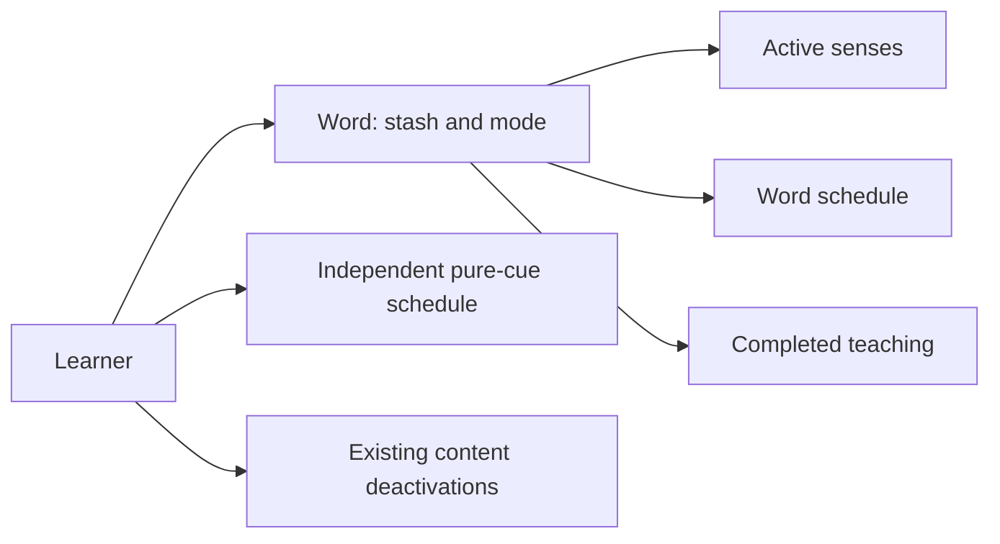
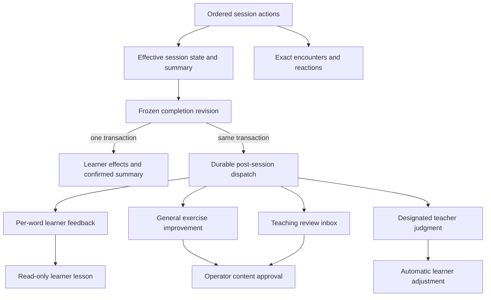
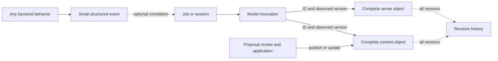

# Vocabulary learning: storage sketch

This is a concrete schema sketch for discussing the build described by the
[early specification](2026-10-15-vocabulary-model-whiteboard.md) and
[first delivery plan](2026-10-16-vocabulary-first-deliverable-plan.md).
Names and fields describe a target to review, not a migration or executable DDL.
Existing tables can fulfill these roles where they fit. This sketch covers the
first delivery, while the early specification describes the fuller experience.
It is organized around content, learner state, session evidence, and backend work.

`PK` identifies a primary key; `UQ` a unique constraint; `→` a real foreign key;
`?` means nullable. IDs are opaque, times UTC, and JSON is structured/versioned.
Repeated audit columns are omitted. Domain rows hold their current data alongside
identity and metadata; dedicated history tables retain changes. Cross-learner
references use composite owner keys, even where the abbreviated sketches show
just an ID. “Same item/word/session” qualifications require matching composite keys;
subtype qualifications such as “exercise” require owning-writer validation or
additional database guards. An identity FK alone does not prove the subtype.

## 1. Words, senses, and content



An exercise is a complete content object: identity, authored material, answer
contract, and serving metadata. An introduction is another content kind with its
own complete teaching material. They share storage, with teaching exercises
explicitly excluded from the general practice pool. Ordinary reads use current
objects directly; history separately records changes to those objects.

### Complete objects and their change history

```text
words
  word_id PK                         existing lexical identity
  hanzi, pinyin                      normalized lexical key; UQ(hanzi, pinyin)
  sense_catalog_version              increments when the catalog changes
  senses_established_at?             absent is distinct from an established catalog

senses
  sense_id PK
  word_id → words
  description_json                   label, definition, examples, usage notes
  status                             active | retired
  version                            versioned object state; separate from later enrichment
  created_at, updated_at

content_items
  content_id PK
  kind                               exercise | introduction
  payload_version
  body_json                          authored presentation/reveal material
  exercise_type?, skill?              required for exercises; production is focus here
  exercise_role?                      teaching | general; required for exercises
  assessment_json?                   response format and deterministic matching rules
  access_scope                       shared | private
  owner_learner_id? → learners        required only for private content
  availability                       active | quarantined | retired
  origin_kind                        model | human | import
  author_kind?, author_id?            original attributable human/service origin
  version                            versioned object state; separate from later enrichment
  created_at, updated_at

content_revision_history              every authored version, including the active one
  change_id PK
  content_id → content_items
  version, previous_version?         UQ(content_id, version); no predecessor at creation
  snapshot_json                      resulting object, answers, and relationships as captured
  change_kind                        created | updated | retired
  write_strategy?                    create | update_existing | replace
  actor_kind, actor_id?, reason_json, recorded_at

sense_revision_history
  change_id PK
  sense_id → senses
  version, previous_version?         UQ(sense_id, version)
  snapshot_json                      full resulting sense, including its word identity
  change_kind, actor_kind, actor_id?, reason_json, recorded_at
```

A newly generated exercise is a complete content row, with a matching initial
snapshot in revision history. A repair updates the object and affected authored
relationship rows and appends its resulting snapshot in one transaction. History
therefore includes every version, including the active one. Each row describes
the content at that version and who created that state, why, and with which update
strategy. Prior snapshots remain immutable; diffs can be derived when useful.

This intentionally duplicates the active authored content. Ordinary reads use
the main row; revision analysis can use history alone, including initial content
that has never been edited. The snapshot includes word associations and accepted
answers so scripts can examine the content relevant to a change without consulting
mutable current relationships. These are the associations known when the snapshot
was written; later sense enrichment and curation have their own change evidence.
Small indexed metadata fields support common revision filters, with full snapshots
available for detailed analysis. The main row and latest history snapshot agree
on versioned object data through the same writer transaction. Independent sense
associations and curation are not part of that equality. No separate mutable
“is current” flag is needed in history: the highest version identifies the latest
recorded state.

For an exercise, accepted lexical answers live in the answer relation below;
`assessment_json` supplies the remaining matching rules. Nonlexical choices and
explanations can live in the typed body/assessment payload. Word IDs embedded in
those payloads are validated by the owning writer; JSON references are not SQL FKs.
Exercises own their presented text without a shared mutable sentence dependency.

The operator chooses whether a repair updates the existing object or replaces it
with a new one. Preserving the ID retains identity-bound references such as
pure-cue scheduling and learner deactivations. Replacement creates a new ID and
retires the previous item, retaining its history. Encounters retain exactly what
was served. Selection checks availability and access scope: shared content or
the requesting learner's private content.

Sense edits retain identity when the use remains the same. Splits/merges can
create and retire identities, retaining lineage in the maintenance operation's
before/after evidence. A word's catalog version identifies the inventory supplied
to model work and supports checks when applying asynchronous results.

Historical references to versioned object data use an ID plus the observed
version. Encounter/model snapshots separately retain the exact context used,
including any sense associations or curation information relevant to that use.
Every object version is available in history, so exact-version pairs can reference
its unique `(object_id, version)` key rather than a mutable current
row. The abbreviated fields below show the identity FK and version separately;
exact-version references also require this composite history FK. Referenced
objects/history are retained. This convention also applies to proposal history below.

### Relationships used for selection

```text
content_words
  content_id → content_items
  word_id → words
  relation                           target | context
  sense_id? → senses (same word)
  sense_mapping_established_at?       null means unresolved
  PK(content_id, word_id)

exercise_answer_words
  exercise_id → content_items (exercise)
  word_id → words
  (exercise_id, word_id) → content_words
  accepted_forms_json                 exact currently supported written forms
  PK(exercise_id, word_id)

content_mode_suitability
  content_id → content_items
  mode                               solidify | practice | maintain
  suitability                        candidate | curated
  assessed_content_version           state for which suitability was assessed
  PK(content_id, mode)

introduction_exercises
  introduction_id → content_items (introduction)
  position
  exercise_id → content_items (exercise)
  exercise_version                   exact teaching exercise selected for coherence
  PK(introduction_id, position)
```

`target` means the content is intended to practise or teach this word. It is not
exclusive: a pure cue can have several target words, each represented by an
ordinary content–word row. `context` covers deliberate supporting relationships,
such as contrast distractors. Exercise type and answer criteria determine whether
the task asks for a particular word or accepts any member of an answer set;
exclusivity is not a property of the individual content–word relationship.

Word relationships and accepted answers remain separate. Every accepted answer
word has a corresponding `content_words` row, but a relationship alone does not
establish answer validity. Selecting a pure cue through one of its targets does
not restrict its accepted answers to that word. Nor does a response establish
independent production success for every target. A contrast distractor can
establish relevance without becoming a correct answer or an enrollment requirement.

Each content–word relationship has at most one sense. A null
`sense_mapping_established_at` means unresolved; an established mapping with a null
`sense_id` means no appropriate single sense was assigned. The assigned sense
must belong to the row's word, and a non-null sense requires an establishment
timestamp. Live reads follow that stable ID to the current sense description;
they do not pin an older representation. Editing the description
of the same sense therefore needs no relationship update. A semantic change that
requires a new sense identity is a separate maintenance operation.

The relationship is between content, word, and sense identities. It outlives
changes to their representations; a new content or catalog version does not
implicitly invalidate or clear it. A change to the relationship is an explicit
operation. Unresolved content remains usable at word level.

Versions considered, invocation identity, and mapping rationale belong in the
job/model evidence and event log. An asynchronous writer checks its captured
inputs against current state before applying a result, including intervening
relationship edits. Those execution safeguards do not require version fields
on the lasting relationship.

This first delivery does not support multiple sense links for one content–word
pair. A word can still have many senses, and a teaching snapshot can record the
several senses introduced. If a content item cannot be usefully assigned one
sense for a word, retain word-level fallback rather than force a false match.
A later demonstrated need can justify a schema change; no linking table or
independent mapping entity is reserved for it now.

General exercise selection requires `exercise_role = general` before applying
mode suitability, availability, and access rules. Teaching exercises belong to an
introduction's explicit repertoire; its writer validates the teaching role.
Teaching and Solidify priming use that repertoire, while later general practice
excludes it. A suitability row cannot override this role boundary. Cross-role
reuse is not required.

Maintain curation attaches to the assessed content version, so an edit cannot
silently inherit trusted status. An introduction binds particular teaching
exercise versions for coherence. Teaching repairs are manually reviewed alongside
the introduction and update the intended exercise bindings explicitly. A
historical binding does not bypass current quarantine, retirement, or access
restrictions. Historical encounters remain readable; fresh teaching requires an
eligible repertoire or the ordinary nonblocking fallback. General selection uses
current content.

Authored changes to answers, target/context membership, or the teaching repertoire
are saved with the content update and its history snapshot. Establishing
a sense association or approving suitability does not itself change the authored
content version. Record association changes with before/after values and execution
provenance transactionally in the basic event log. Retain these records as domain
change evidence. Encounters and model inputs snapshot the mapping
they actually used; they do not later infer it from the mutable inline fields.
Authored-content history does not claim to version this subsequent enrichment.
Curation changes use the same retained change-record approach.

### Contrast context

```text
contrast_clusters
  cluster_id PK
  description_json
  status

contrast_members
  cluster_id → contrast_clusters
  word_id → words
  PK(cluster_id, word_id)

exercise_contrast_context
  exercise_id → content_items (exercise)
  cluster_id → contrast_clusters
  PK(exercise_id, cluster_id)
```

These retain cluster relevance without creating another learning lifecycle.
The exact choices, correct choice, and explanation belong to the exercise
object. Changing cluster membership cannot change an already-authored question.
Sense-level cluster links can be added when a concrete policy needs them.

### Important reads and indexes

| Read | Index beyond the primary/unique keys |
| --- | --- |
| Current senses for a word | `senses(word_id, status)` |
| Candidate exercises for a word | `content_words(word_id, relation, content_id)`; join content and require general exercise role plus availability/access |
| Exercises mapped to a sense | `content_words(sense_id, content_id)` where sense is non-null; join the current sense |
| Exercises accepting a word, including pure cues | `exercise_answer_words(word_id, exercise_id)`; join `content_items` and filter by `exercise_type` for pure cues, plus general role and availability/access scope |
| Mode repertoire | `content_mode_suitability(mode, suitability, content_id)`; require general role and check assessed version |
| Teaching repertoire | `introduction_exercises` primary key; resolve bound versions and validate teaching role/availability |
| Associated legacy content awaiting mapping | `content_words(word_id, sense_mapping_established_at, content_id)` |
| Contrast clusters involving a word | `contrast_members(word_id, cluster_id)` |
| Any retained content/sense object version, including current | Unique `(content_id, version)` and sense equivalent in history |
| Content matching revision criteria | `content_revision_history(change_kind, recorded_at)` and `(write_strategy, recorded_at)`; inspect snapshots for word/content criteria |

## 2. Learner state: small mutable records



```text
learner_words
  (learner_id → learners, word_id → words) PK
  in_stash, added_at
  intended_use_text?
  mode                               unstudied | solidify | practice | maintain
  mode_changed_at, state_version
  scope_established_at?               legacy unknown scope remains explicit

learner_senses
  (learner_id, word_id) → learner_words
  sense_id → senses (same word)
  disposition                        active | excluded
  PK(learner_id, sense_id)

learner_word_schedules                production scheduling, separate from mode
  (learner_id, word_id) PK → learner_words
  next_eligible_at?, last_practised_at?
  policy_version, scheduler_state_json, state_version
  refresh_requested_at?, refresh_until?

learner_pure_cue_schedules
  (learner_id → learners, content_id → content_items) PK
  next_eligible_at?, last_practised_at?
  policy_version, scheduler_state_json, state_version

learner_content_deactivations
  (learner_id → learners, content_id → content_items) PK
  deactivated_at

teaching_completions                  completed teaching only
  teaching_id PK
  (learner_id, word_id) → learner_words
  completion_id? → session_completions
  introduction_id? → content_items (introduction)
  introduction_version?
  taught_snapshot_json               exact material + known sense IDs/versions introduced
  completed_at
  source_key UQ                      new completion identity or imported legacy identity
```

The word mode does not live in either schedule. Scheduling JSON retains the
existing algorithm's useful state; indexed eligibility times support selection.
A direct mode transition does not reset evidence. A policy can separately adjust
a schedule, and refresh leaves mode unchanged. `refresh_until` is a bounded
request window; the eventual composition policy must implement the promised
attention within it rather than treating it as an ordinary optional weight.

Pure-cue schedule rows require a pure-cue content identity. They do not require
a `learner_words` row for every accepted word. Recognition retains its existing
scheduling path for this delivery; this sketch does not invent a general skill
registry or per-sense SRS system.

Establish learner sense scope when teaching or resolving legacy scope. An
unresolved scope stays usable at word level; no migration invents exclusions or
mastery. No sense modes, preference weights, or override UI are needed initially.
`learner_senses` supplies the basic relationship, not a promise to ship all scope
editing controls. Imported teaching can use a retained snapshot without inventing
an introduction object or a new-model session completion.

| Read | Index |
| --- | --- |
| Stash / mode view | `learner_words(learner_id, in_stash, mode, added_at)` |
| Production scheduling candidates | `learner_word_schedules(learner_id, next_eligible_at)`; join mode |
| Outstanding refreshes | `(learner_id, refresh_until)` where `refresh_requested_at IS NOT NULL` |
| Pure-cue sampling / due candidates | `learner_pure_cue_schedules(learner_id, next_eligible_at)`; stronger sampling fields only if policy needs them |
| Active senses of a learner's word | `learner_senses(learner_id, word_id, disposition)` |
| Most recent familiar teaching | `teaching_completions(learner_id, word_id, completed_at DESC)` |

## 3. Session evidence and finalization



```text
study_sessions
  session_id PK
  learner_id → learners
  protocol_version, started_at, closed_at?
  status                             active | finalizing | closed

session_actions                      append-only authoritative session log
  action_id PK
  (learner_id, session_id) → study_sessions
  sequence_number                    UQ(session_id, sequence_number)
  client_action_id                    UQ(session_id, client_action_id)
  kind, payload_version, payload_json
  encounter_id? → exercise_encounters (same session; responses and exercise controls)
  word_id? → words                    word-level controls and teaching actions
  occurred_at, recorded_at
  undoes_action_id? → session_actions (same session)

exercise_encounters                  typed evidence attached to a presentation action
  encounter_id PK
  presented_action_id UQ → session_actions
  (learner_id, session_id) → study_sessions
  content_id → content_items (exercise)
  content_version                    state actually served
  context_json                       selected-through word, active senses, mode, priming,
                                     policy version and inline mapping snapshots used
  served_snapshot_json               exact rendered material + immediate answer contract
  presented_at

encounter_words
  (learner_id, encounter_id) → exercise_encounters
  word_id → words
  role                               selected_through | target | context
  PK(encounter_id, word_id, role)

learner_feedback                     learner reactions; retained physical table name
  feedback_id PK
  learner_id → learners
  source_action_id? UQ → session_actions (same learner)
  encounter_id? → exercise_encounters (same learner)
  content_id? → content_items
  content_version?
  target_snapshot_json?              exact content for reactions outside an encounter
  word_id? → words
  kind, payload_json, created_at

session_completions                  adapted existing finalization revision
  completion_id PK
  (learner_id, session_id) → study_sessions
  revision_number                    UQ(session_id, revision_number)
  through_sequence                   frozen action boundary
  staged_at, close_at
  status                             pending | cancelled | closed | failed
  input_json, report_json, policy_version
                                     includes finish reason and covered/uncovered word outcomes
  closed_at?, last_error?

learner_state_effects                 attributed, idempotent durable effects
  effect_id PK
  learner_id → learners
  word_id? → words
  pure_cue_content_id? → content_items
  completion_id? → session_completions (same learner)
  judgment_id? → teacher_judgments
  source_action_id? → session_actions (same learner)
  effect_key UQ
  kind, before_json, after_json, applied_at
```

Answers, immediate assessments, skip, more practice, word wrap, teaching
completion, finish requests, mode choices, and undo are session actions. Encounter
and in-session reaction rows are typed extensions written with their originating
action. A retry reuses the client action ID. Ordinary Undo references the latest
undoable transition and changes its contribution without deleting evidence.
Returning to an earlier word creates fresh practice. Skip changes continuation;
it neither fabricates recall success nor deletes the miss or reaction. Dismiss
and suppress controls live outside the session UI.

“Finish for now” stops new admission and wraps in-flight work. “Finish immediately”
is available during that phase and ends without requiring remaining coverage.
Before staging completion, the frontend sends its remaining actions and confirms
the recorded boundary; save failures remain retryable. Finalization retains the
existing fixed deadline and cancellable revision approach. It freezes that
boundary, applies learner effects, confirms the report, and queues work atomically.
Uncovered words remain due for subsequent selection and participate in post-session
processing. Incomplete teaching creates no teaching completion, but its evidence
is retained. Richer active-session recovery can be added later.

Resuming before closure requires cancelling the pending revision before accepting
new actions. Closed sessions reject late mutations. A later reversal of a mode
recommendation is a new mode command, not a reopened completion.

Compensation is automatic backend work from a designated judgment. Effect keys
identify the source outcome and adjustment, so separate calls or retries cannot
compensate it twice. It does not depend on message viewing or content approval.
Use an explicit, simple policy against the schedule at application time; delayed
judgments and mixed exercise outcomes do not require full historical replay.
Retain before/after values and provenance. Scheduling adjustments do not overwrite
explicit learner mode choices.

| Read / guarantee | Index or constraint |
| --- | --- |
| Replay or resume session | Unique session/sequence index; unique session/client-action index |
| Responses and controls for an encounter | `session_actions(encounter_id, sequence_number)` where encounter is non-null |
| Inspect an exercise's encounters, optionally by version | `exercise_encounters(content_id, content_version, presented_at)` |
| History relevant to a learner's word | `encounter_words(learner_id, word_id, encounter_id)`; join encounters for time and session |
| Content reaction queue | `learner_feedback(content_id, created_at)` |
| Close overdue completions | `session_completions(status, close_at)` |
| One pending/failed completion per learner | Unique partial `session_completions(learner_id)` for those statuses; retain existing finalization contract |
| Explain learner state changes | `learner_state_effects(learner_id, word_id, applied_at)` and cue equivalent |

## 4. Backend judgment and manual repair

```text
backend_jobs                         adapt existing preparation/dispatch job records
  job_id PK
  kind, dedupe_key                    UQ(kind, dedupe_key)
  completion_id? → session_completions
  requesting_learner_id? → learners   attribution, not ownership of generated content
  input_json                         frozen IDs/versions/snapshots and workflow input
  status, next_attempt_at, attempt_number
  lease_token?, lease_expires_at?, last_error?

reflection_cases                     internal work; evidence remains private
  case_id PK
  kind                               learner_feedback | exercise_improvement | teaching_review
  source_job_id? → backend_jobs
  learner_id? → learners              required for per-learner feedback
  word_id? → words                    required for per-word feedback
  content_id? → content_items         exercise/teaching review subject
  status, evidence_snapshot_json, created_at

reflection_case_evidence
  case_id → reflection_cases
  encounter_id? → exercise_encounters
  feedback_id? → learner_feedback
  exactly one evidence reference per row; unique edge

teacher_judgments                    retained interpretation, separate from immediate grade
  judgment_id PK
  case_id → reflection_cases
  invocation_id? → model_invocations
  supersedes_judgment_id? → teacher_judgments (same case)
  diagnosis_json, created_at

content_proposals
  proposal_id PK
  case_id? → reflection_cases
  operations_json, rationale_json    includes per-operation write strategy and rationale
  author_kind, author_id?, invocation_id? → model_invocations
  version                            operations/rationale/base-reference state
  status                             draft | awaiting_review | approved | applied | closed

proposal_revision_history             every proposal version, including the active one
  change_id PK
  proposal_id → content_proposals
  version, previous_version?         UQ(proposal_id, version)
  snapshot_json                      includes operations, rationale, and base references
  actor_kind, actor_id?, reason_json, recorded_at

proposal_content_bases
  proposal_id → content_proposals
  content_id → content_items
  expected_content_version
  PK(proposal_id, content_id)

proposal_reviews
  review_id PK
  proposal_id → content_proposals
  proposal_version                   exact state reviewed
  operator_id, disposition, notes_json, reviewed_at

proposal_applications
  application_id PK
  proposal_id → content_proposals
  proposal_version                   UQ(proposal_id, proposal_version)
  authorized_review_id → proposal_reviews (same proposal + version; approving disposition)
  idempotency_key UQ
  status, effects_json, applied_at?, last_error?

application_content_changes
  application_id → proposal_applications
  operation_key
  write_strategy                     create | update_existing | replace
  source_content_id? → content_items
  source_version?
  result_content_id → content_items
  result_version
  source_history_change_id? → content_revision_history (same source content)
  PK(application_id, operation_key)

learner_messages                     read-only feedback, no approval/compensation controls
  message_id PK
  learner_id → learners
  case_id? → reflection_cases         feedback case for this learner and word
  judgment_id? → teacher_judgments
  source_key UQ
  body_json, created_at, seen_at?
```

The jobs block shows a common minimum shape, not a requirement to replace trusted
workers with a generic DAG engine or one physical job table. Preparation, legacy
sense establishment, reflection, and retries need durable inputs and fenced
execution. Job kind plus an appropriately scoped dedupe key identifies logical
work; provider invocation rows record its individual call attempts.

Learner-feedback cases group a word's encounters into a lesson, generated in a
call independent of internal improvement. General improvement cases investigate
an interaction or exercise. Teaching issues route to a separate manual inbox,
paired with the introduction and teaching exercises, outside ordinary reflection
repair. These work kinds can share job and evidence infrastructure without sharing
approval or completion gates. Core linguistic reasoning is preserved; call
boundaries and evidence/output contracts can change to support these roles.
New content remains usable with unresolved sense associations.

Case evidence includes reactions without an answer and uncovered work. A case can
link multiple encounters; grouping or deferral for a model call does not discard
its pending evidence. Do not reuse legacy review-only or overlapping-word admission
filters as eligibility rules. Preserve actual exercise purpose, priming, responses,
and learner comments without inventing attempts for skipped exercises.

Learner messages, automatic compensation, and content proposals have independent
application semantics. The backend designates the judgment that drives a scheduling
adjustment rather than allowing both feedback and improvement calls to apply it.
This does not require a third model call; the owning workflow is an implementation
choice. Reading a message neither authorizes nor triggers compensation. Internal improvement
may proceed independently of feedback generation. Shared content and learner-only
effects are explicitly scoped in the operator preview; legacy operation names do
not implicitly authorize global retirement or change a word's mode.

Manual approval refers to the exact proposal version; editing requires review
again. Proposal history retains resulting authored state and bases; workflow
status is recorded through reviews/applications. Applying a proposal checks its
bases and records the content change with its receipt atomically. Stale approvals
cannot overwrite newer repairs. New-content operations create an initial history
snapshot; retries reuse the application for the approved version. Typed change
links connect published states to approval; `effects_json` retains other effects
such as availability changes. Teaching review uses this same approval machinery
with its introduction/repertoire context.

### Operator choice of update strategy

The repair editor offers two choices for an existing item, with a preview of
their consequences before approval:

| Choice | Content effect | Relationship consequences to show |
| --- | --- | --- |
| Update this item | Preserve ID; update current data and append its resulting history snapshot | Existing schedules and deactivations remain attached; identify mappings, curation, or teaching bindings affected by the edit |
| Replace with a new item | Create a complete new object; retire the old one atomically | Show the predecessor/successor link and explicitly describe what happens to schedules, deactivations, and teaching bindings |

Replacement is not physical deletion. It does not automatically transfer every
reference, reset learner state, or broaden access. Any relationship transfer or
learner-state effect is a separate, visible part of the approved operation.
The existing history and source evidence stay attached to the old item. An
additional alternative that leaves the old item active is an ordinary creation,
not a replacement. Both strategies preserve exact prior encounters.

The choice is per operation, stored in the proposal alongside a short operator
rationale, then copied into the application receipt with the actual source and
result IDs/versions. Changing the strategy changes the proposal version and
requires approval of the new preview. For updates, source and result IDs match;
for replacements they differ; creation has no source. The source history link
records its update or retirement. Retries reuse the saved application and cannot
create a second replacement.

Initially, these are operator decisions rather than a hard-coded taxonomy of
which edits deserve which strategy. Retain the proposed edit, selected strategy,
operator rationale, and application effects together. Subsequent encounters and
reactions can join through the source/result IDs, allowing later analysis to compare
the choice with what happened. These cases form evidence for concrete agent
guidance as intuition develops; no decision-model evaluation framework is needed.

Case evidence, invocation payloads, and private learner messages remain internal
or learner-scoped. A shared output has public authored content, not public access
to the case that produced it. Operator identity uses existing authentication;
no new identity system is implied. Model-evaluation trials add no first-delivery
tables. Existing reflection and operator-editor records can be adapted into these
roles rather than retained as parallel proposal systems.

| Read / guarantee | Index |
| --- | --- |
| Claim eligible jobs / recover expired work | `(status, next_attempt_at)`; running jobs by `lease_expires_at` |
| Find case handling a reaction | Unique evidence edges; reverse `(feedback_id, case_id)` and `(encounter_id, case_id)` |
| Manual proposal review | `content_proposals(status, proposal_id)`; join case kind |
| Teaching issue inbox | `reflection_cases(kind, status, created_at)`; include issues without proposals |
| Feedback for a learner/word | `reflection_cases(learner_id, word_id, kind, created_at)` |
| Inspect review history | `proposal_reviews(proposal_id, proposal_version, reviewed_at)` |
| Find competing repairs | `proposal_content_bases(content_id, proposal_id)` |
| Trace a published repair to its approval | `application_content_changes(result_content_id, result_version, application_id)` |
| Find replacements and update choices for an item | `application_content_changes(source_content_id, application_id)` |
| Unread learner feedback | `learner_messages(learner_id, created_at)` where `seen_at IS NULL` |

## 5. Basic events and model provenance



```text
backend_events                       append-only, easy to emit
  event_id PK
  occurred_at, recorded_at
  name, payload_version, data_json
  actor_kind?, actor_id?
  learner_id?, session_id?, job_id?
  causal_event_id?
  entity_kind?, entity_id?            flexible diagnostic reference, not a SQL FK

model_invocations                    one actual provider call attempt
  invocation_id PK
  job_id? → backend_jobs
  step_name?, attempt_number?
  actor_kind, actor_id?, requesting_learner_id? → learners
  provider, requested_model, resolved_model?, provider_request_id?
  prompt_name, prompt_version, prompt_hash
  output_schema_name, output_schema_version
  prompt_snapshot, output_schema_json, input_projection_version
  settings_json                      reasoning, token limits, temperature, etc.
  request_snapshot_json, response_snapshot_json?
  started_at, finished_at?, status, latency_ms?
  usage_json?, cost_json?             retain pricing basis; unknown remains unknown

invocation_content_links
  invocation_id → model_invocations
  content_id → content_items
  content_version
  role                               input | output | revised_from | evaluated
  PK(invocation_id, content_id, content_version, role)

invocation_sense_links
  invocation_id → model_invocations
  sense_id → senses
  sense_version
  role                               input | output | evaluated
  PK(invocation_id, sense_id, sense_version, role)
```

An ordinary event needs only its name, JSON data, and automatically supplied
identity/times. Context is optional and can be inherited from the caller. The
diagnostic references are deliberately loose: logging a failed lookup must not
require that its target exists. Domain evidence uses the real FKs shown elsewhere.
Scripts can filter stable envelope fields and inspect versioned JSON. Do not add
an index for every payload key before a concrete query needs it.

The session action log and application receipts are authoritative records written
with the business operation. The general event facility also carries durable
change evidence where it is the retained account of a change, such as a sense
association or curation decision. Those events are written in the same transaction
as the change and retained with the domain evidence. They cannot be dropped or
expired under an ordinary diagnostic-retention policy. This uses the same simple
event format; it does not require another logging subsystem. Events recording
requests or failed attempts still do not assert that an effect occurred.

Invocation payloads may be inline initially or stored through immutable artifact
references later. They exclude credentials. Retaining template hashes without the
actual templates/inputs would not support reconstruction. Starting a call before
sending it preserves an unknown-outcome record if the process dies; do not infer
zero cost or safely retryable work merely from a missing response.

Provenance links explain derivation, not live dependencies. Human/import origins
remain recorded without a fabricated invocation. Proposal rows link their calls
directly; sense-association events link the relevant model work; application
receipts connect approved proposal versions to published changes. Invocation
snapshots retain the exact model inputs and outputs; object-version links support
joins without substituting mutable current text.
No universal registry of every entity is needed.

| Read | Index |
| --- | --- |
| Event stream / type over time | `backend_events(recorded_at, event_id)`; `(name, occurred_at)` |
| Entity timeline | `(entity_kind, entity_id, occurred_at)` |
| Session or background trace | `(session_id, recorded_at)` and `(job_id, recorded_at)`, partial for non-null refs |
| Prompt/model cohort | `model_invocations(prompt_name, prompt_version, started_at)`; add model filter/index when needed |
| Calls within a job | `model_invocations(job_id, step_name, attempt_number)` |
| Origin of a content/sense state | Reverse `(content_id, content_version, role, invocation_id)` and sense equivalent |

## 6. Conversion seam and choices to refine

A small `legacy_content_imports(source_kind, source_id, source_sub_id,
content_id → content_items, imported_content_version)` relation
with a unique old identity preserves package-scoped exercise identities and makes
conversion repeatable. Use a non-null empty sub-ID where no sub-identity exists.
Old learner history remains available; it is not fabricated into session actions.
No sense-generation calls are part of conversion. Existing sense data can seed
the catalog, with unresolved mappings and learner scope represented explicitly.

The main design choices to review before implementation are:

- **Operator update preview:** precise relationship handling for each strategy,
  particularly pure-cue scheduling and teaching/maintain curation. Classification
  guidance can follow from retained operator decisions and subsequent evidence.
- **Sense evolution:** how new/split/merged senses affect an established learner
  scope and when to explicitly reassess relationships. References preserve evidence
  without settling those policies.
- **Compensation policy:** choose the authoritative judgment output, initial
  scheduling effects, and simple delayed adjustments for mixed exercise outcomes.
  Application is automatic and independent of feedback viewing/content approval;
  full scheduler replay is not required.
- **Physical consolidation:** which existing finalization, preparation, reflection,
  and operator-review tables take these roles; exact constraints, retention, and
  event-write failure behavior.

The sketch adds no preference engine, evaluator framework, per-sense lifecycle,
shared sentence graph, or exhaustive due-work obligation. Its central read path
is small: learner word mode and schedule → relevant eligible content object →
exact session evidence. Backend judgment and content repair operate on that
retained evidence without trapping the live session.
