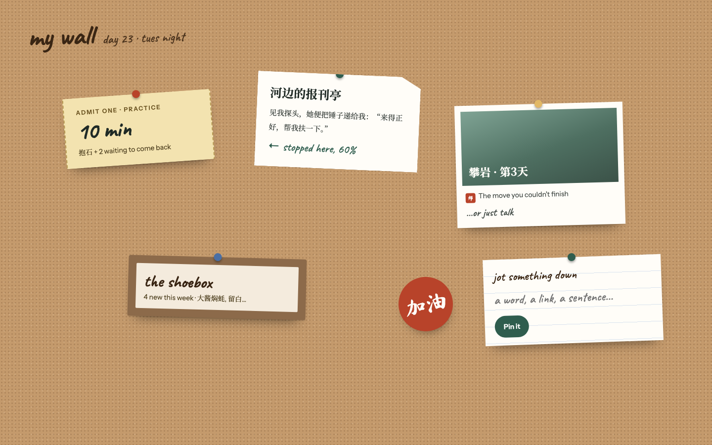

# The journal's interface

**Status: a living document.** Last rewritten on Nov 25, 2026, from a design
conversation with Justin. Items are **Settled** (agreed with Justin),
**Observed** (what the build does, dated) or **Open**. Small factual fixes go
straight into the text. Bigger thinking is added, dated, under
[Feedback awaiting the rewrite](#feedback-awaiting-the-rewrite) and folded in
at the next rewrite. Decisions are added to the [log](#decision-log).

This document is for anyone shaping what the learner sees and touches: Home,
the rooms, the tutor and the conversation partner, and the phone.
[The learning model](MODEL.md) covers what is practiced and why, and
[Media on the board](MEDIA.md) covers pictures. This document links to them
rather than restating them.

## Focus now

**Build the interactive base first: the desktop's urban plan, its landmarks,
and Talk with projects.** These are the most stable parts of the product, and
using them will tell us how everything else should behave. The rest of the
vision waits in [Later](#later) until there is a solid base to attach it to.
Built too early, it would dangle.

## The vision: a town you come back to (settled)

### What opening the app should feel like

1. **"I want to do a little Chinese, but I don't know what."** The intent is
   vague, close to the urge to doom-scroll. Home offers a few options that
   are different enough from one another that one of them fits the learner's
   mood and setting.
2. **"What am I in the middle of?"** The interesting progress is the work in
   motion, not a record of what went well.
3. **"Oh, that's me."** The page shows the person who put themselves into
   it, the way a MySpace page did, even in its chaos. Today's dominant
   platforms rarely allow that.

### The town

The model is a town in a Pokémon game. Every town has a mart, a Pokémon
Center and a gym, so a player always knows how to get around. Each town also
has its own color and flair. The core places are reliable and still crafted;
what's inside them changes.

**V1 has four landmarks and a way in:**

| Landmark | Leads to | Today's offer, for example |
| --- | --- | --- |
| **Practice** | A practice session | "10 minutes · 2 words waiting for recall" |
| **Read** | The reader | The reading underway, or bringing in a new one |
| **Talk** | The root chat and projects | Pick up a project, or just talk |
| **Scrapbook** | Everything the learner has kept, as a room | What was added recently |

Plus the **capture bar**: the companion loop's way in. It can evolve beyond a
bar, but its job keeps it close to an entry field.

Rules for the landing page:
- **Nothing goes on Home that doesn't lead somewhere.** The one exception is
  a single, deliberate decorative touch.
- **Every landmark carries today's offer, not a generic label.** "Pick up the
  climbing project" is alive; "Conversation" is not.
- **Purpose comes before tidiness.** A crowded page where every item has a
  reason is acceptable for now. Actual use will show how things should sit.
  If crowding becomes a problem, the time dimension can help: rotating what
  is shown rather than showing everything at once.

**The look: the wall** (chosen Nov 25). Home's surface is a board of
physical things pinned up slightly crooked: a ticket for Practice, a
dog-eared page for Read, a postcard for a project, a shoebox for the
Scrapbook, and a notepad slip for capture. The town remains the metaphor for
stepping inward from the board into rooms.

The alternatives that were sketched are
[the desk](design/urban-plan-desk.png), [the town](design/urban-plan-town.png)
and [one invitation](design/urban-plan-invitation.png). The originals, with
notes and interaction ideas, are on Justin's private design canvas
(page "Urban plans"). The images here are the copy agents can rely on.

### Rooms

The learner steps from Home into a room. Rooms can be shaped very
differently, but they are built from the same materials: the same paper, the
same tutor, the same way back, and no form chrome.

- **Read** is the most finished room.
- **Practice** keeps its focus: it is the one place where Typeform-style
  focus, one thing at a time, is the reference.
- **The Scrapbook** is what today's Home table becomes: the collection of
  pieces, behind its own door. Later, as the town matures, highlights from it
  can surface on the main canvas.
- **Talk** holds the root chat and projects ([below](#talk-and-projects)).

### Talk and projects

A conversation on its own is not interesting; there are endless chatbots.
What it is about is what matters. Many conversations are projects without a
deliverable: talking builds a shared understanding of something. Projects
mostly failed in general chat apps because people's threads are random. Here,
every thread shares one goal, getting better at the language, so a project is
a natural question rather than an organizing chore.

- **The root chat** is a long-running, get-to-know-you conversation: "you
  learn here by being yourself; tell me what you're into, why Chinese, what
  you'd happily talk about." It is the onboarding and the place to just talk.
- **Projects emerge from it, or the learner declares them:** cook a few
  Chinese dishes, pitch their software app, talk about climbing movement at
  the gym. The tutor suggests projects from the root chat, right away or
  over time.
- **The tutor owns a project's arc, and the partner plays its scenes**
  (tentative). The tutor frames, plans, debriefs and feeds practice. The
  partner is the investor hearing the pitch, or the friend at the gym.
- **An episode is structure that's offered, not required.** Entering a
  project can open a short episode: the tutor's frame (perhaps interactive
  content or slides), a scene with the partner, and free production as the
  last beat. The learner can skip the frame or stay in the scene. Start with
  episodes the learner opens; a daily schedule would turn a project into a
  course.

### Two characters: where structure lives

The split between the characters is also the split between structure and
openness, so the learner can tell which mode they're in by who is speaking.

- **The tutor** is the structure: framing, beats, explanation, debrief,
  practice. It is a companion with a long-running shared context, shown as a
  side sheet. It may open the door to a scene and debrief after it, but it
  never plays a scene.
- **The partner** is the openness. It is inside the bubble with the learner
  and mostly unaware that it is part of a learning system. It never takes a
  teacher's stance, but it does what a friend would:
  - **explains a term when asked,** or when the conversation needs it, the
    way a native-speaker friend explains climbing vocabulary at the gym;
  - **checks its understanding** when the learner is unclear. Confirming
    ("you mean …?") naturally recasts the idea in a more natural way. If the
    guess is wrong, asking for clarification is what a friend would do.
  
  Grammar patterns and natural expression belong to the tutor. What the
  partner explains or recasts counts as shown, so practice can follow it
  ([MODEL principle 5](MODEL.md#principles)).

### Who shapes the page

The ideal is that **we craft the frame and the learner makes the surface:**
learners arrange their own desk of content, practices and toys inside a frame
that stays coherent, moving the product toward a platform. For now, we control
both, partly so support stays tractable.

### Phone

Phone and desktop may differ in layout and use patterns, but the feel,
philosophy and rules are shared. The phone is likely a street of shopfronts
built from the same small set of landmarks, with no bulletins on the landing
page. A town that only works with everything visible at once leans on screen
size rather than structure.

## Later

These parts of the vision are valuable in a mature app, but they wait for the
base.

- **What's alive.** A handful of post-its, not twenty, for recent points that
  are still solidifying, perhaps cycling. Each one leads with its tie to the
  past (the moment or scene it came from), with the language point
  underneath. They are decoration with a hint of study.
- **The growth arc.** Traces on a piece of what happened to it: taught,
  settling, used unprompted, without becoming a progress bar.
- **Gathering.** While browsing, the learner pockets a few pieces into a pile
  that seeds today's session or jumps the queue, like Spotify's "Up next". It
  is a gesture, not a second queue to manage.
- **Busy items.** Their contents never show on the landing page by default.
  Their styling shows that a lot is attached, which invites interaction.
  Interacting gives a peek; clicking enters the item's room.
- **Trinkets with depth,** such as a study session around a theme, and
  **semantic zoom** into a theme that fills the view.
- **Context for bare pieces:** an anchor in the learner's interests, or a
  synthetic scene labeled as one.
- **Landmarks that come and go** by day, or that the learner chooses.
- **Tutor refinements:** how Conversation shows two characters, the tutor
  sheet's shape, and the tutor's language.

## Principles

These are ordered by how often they decide something.

1. **Home shows the growth edge, framed by memory. It is not a ribbon
   board.** [Production is the product](MODEL.md#principles), but that
   describes what the learner *does*, not what Home *displays*. Showing a
   sentence the learner said well feels bland or condescending. Corrections
   and points still in progress belong on Home, but each leads with the moment
   it came from, not with the error.
2. **The memory is what makes it ours.** A piece with a real tie to the past
   is better than any lock-screen widget. Capture can invite a line of
   context without nagging. **Synthetic context must say so:** "a scene for
   you" is fine; an invented "that night you…" is not. This is the same
   truthfulness rule as for [pictures](MEDIA.md).
3. **Ambient isn't study.** Seeing something on Home counts as no evidence and
   never becomes a schedule ([MODEL principles 2 and 4](MODEL.md#principles)).
   Serious study happens in sessions.
4. **Themes emerge or are declared, never forced.** A single rich item is its
   own theme. Grouping starts once material builds up across sources. A
   project is a theme the learner declares.
5. **Structure is offered, never required.** It lives in the tutor's voice,
   and the learner can always step off it.
6. **Points are a means.** The aim is intuition. A point's life ends in
   *absorbed*, not *mastered*.
7. **Three loops, each with a place in the town:**
   - *companion*: the capture bar and the tutor;
   - *gym*: Practice;
   - *journey*: Talk, projects and the Scrapbook.
8. **Voices.** Learner surfaces speak in a companion voice (warm, in the
   moment) or an instrument voice (orientation, such as how much is left).
   The workshop voice (machinery and queues) belongs only in operator views
   such as Model activity.
9. **Words are promises; hide the mechanics.** A label must be true. Always
   show how much is left and how to leave. Design the bad day: a miss, a week
   away, a tutor that's wrong.
10. **Controls appear on selection.** Hover is only a desktop accelerator.

**References.** The mood is a scrapbook that feels alive, made with craft.
- software.inc: intriguing even when it's confusing.
- MySpace: the person showing through the page.
- Pokémon towns: reliable landmarks, each with local flair.
- Typeform: for the practice session only.

The anti-model is the AWS console, where machinery is exposed as UI.

**How we work.** Design is product philosophy: it decides what to build next.
Language can run ahead of what the app can do; affordances must match it.
North-star sketches are tagged exists, cheap, or far.

## Where the build is (observed Nov 24, 2026)

This was observed on the fixture and on a copy of Justin's dogfooded journal.

**Works:**
- **Read** is full-bleed paper with a small way back and a tucked-away tutor.
- **Practice** opens with a scene in large type and shows how much is left.
  It ends with *Keep going* or *Back home*.
- **Home's today card** offers one next step. It is the seed of a landmark
  offer.
- **The scrapbook table** has the right materials for the Scrapbook room:
  paper cards, the tutor's quiet 师 mark, credited picture clippings, and
  Loose ends.
- **Conversation** already produces real language: long turns in Chinese
  about things the learner cares about.

**Gaps against the focus:**
- **There is no town.** Home is the scrapbook table, with the today card as
  the only landmark.
- **Practice and Conversation are the old house.** They use a masthead, a
  large H1 and `<select>` controls ("Session: Daily mix", "Topic"). "Daily
  mix" names a mode, but modes are
  [dropped](MODEL.md#what-the-hosted-app-contributes) as a learner-facing
  concept.
- **Talk has topics, not a root chat or projects.**
- **The phone layout is broken.** Clusters run off the edge and the capture
  bar covers content.

## Open questions

**Focus:**
1. **The desktop urban plan.** How do the four landmarks and the capture bar
   sit together? What makes each landmark crafted rather than a button, and
   where does the one decorative touch go?
2. **Landmark offers.** Which offer does each landmark carry, and who chooses
   it: rules, the tutor, or both?
3. **The root chat.** How does it open for a new learner and for a returning
   one? When and how does the tutor suggest a project from it?
4. **A project's first episode.** What do the frame, scene and free
   production look like? How does the tutor plan, and how does a project
   feed practice? Can the frame reuse the lesson-card beats?
**Later:** see [Later](#later). Desktop Home's eventual composition with the
Scrapbook's highlights also waits there.

## Prototype-stage tradeoffs

These describe the prototype now, not lasting rules.

- **Old content is fixed going forward, not backfilled.** Interactive content
  goes stale naturally, and learners keep going forward. When keeping
  historical data up to date would block an otherwise clear solution,
  accepting stale data is usually the right trade.
- **We control both the frame and the surface** while the product's dynamics
  are still being found.
- **A crowded Home is acceptable** as long as every item leads somewhere.

## Feedback awaiting the rewrite

- *(Nov 25)* **Urban plans sketched** on the design canvas (page "Urban
  plans"): A the desk, B the town, C the wall, D one invitation, plus small
  interaction ideas. **Justin chose C, the wall,** and supports all the small
  ideas: doors not links, peek on focus, time-of-day light, capture showing
  where it went, visible characters, fresh and stale offers, a keyboard town,
  and rotation instead of a carousel.
- *(Nov 25)* **Why the wall wins (Justin).**
  - **Physical things are the core.** Each landmark is a distinct object, and
    the input itself becomes an object on the board (the notepad slip).
    It has the town's visual variety but fits this app better.
  - **The metaphors split.** The open board is Home's surface. The town
    stays the metaphor for drilling in, from the main page into specific
    worlds. "Doors, not links" fits this split.
  - **Crookedness and handwriting are fine for now.** Crookedness could get
    old. The handwriting font could be better but isn't a problem.
  - **It suggests personalization without supporting it yet.** The board
    and the crookedness read as personalizable even though they're not
    "my wall" today. That is language running ahead of capability, which is
    allowed. Real personalization, such as learner stickers, can come with
    traction.
  - **The material** (cork, warmth) works. **The sticker** is cheesy but
    cute, and it is the one decoration.
  - **A small real gesture would be welcome but isn't essential:** for
    example, the learner can drag a pinned thing to re-pin it, and it stays
    where they put it. It makes the ownership feeling honest.
    Re-pinning works only after the learner picks the thing up (select,
    then drag), so a stray drag while panning never rearranges the wall.
    This follows "controls appear on selection".

## Decision log

| Date | Decision | Where it came from |
| --- | --- | --- |
| 2026-11-22 | Scrapbook direction, three loops, points as means | Design consultation (Steward inbox, Nov 22) |
| 2026-11-23 | Controls appear on selection; tutor as a side sheet; picker mode | Consultation follow-up |
| 2026-11-23 | Media: per-case ceilings under a demote-only composition policy | [MEDIA.md](MEDIA.md) |
| 2026-11-23 | Desktop proves the model first; phone soon; shared philosophy | Consultation follow-up |
| 2026-11-24 | The conversation partner is a separate character inside the bubble, mostly unaware of the learning system | Justin, review of this document |
| 2026-11-24 | Home is a town: landmarks with today's offer; what's alive and the collection come later | Justin, design conversation |
| 2026-11-24 | No ribbon board: Home shows the growth edge, each piece leading with its memory | Justin, design conversation |
| 2026-11-24 | Themes emerge or are declared (projects), never forced | Justin, design conversation |
| 2026-11-24 | Ambient display counts as no evidence; study happens in sessions | Justin, design conversation |
| 2026-11-24 | Aim for "we craft the frame, the learner makes the surface", later; we control both for now | Justin, design conversation |
| 2026-11-24 | Typeform is a reference for the practice session only | Justin, design conversation |
| 2026-11-24 | Focus: the desktop urban plan, landmarks and projects. Defer what's alive, the growth arc, gathering, busy items and the tutor refinements | Justin, design conversation |
| 2026-11-24 | V1 Home holds nothing that doesn't lead somewhere, except one decorative touch | Justin, design conversation |
| 2026-11-25 | A long-running get-to-know-you root chat is the onboarding and the source of projects; projects can also be declared | Justin, design conversation |
| 2026-11-25 | Desktop V1: the scrapbook becomes a room behind its own landmark | Justin, design conversation |
| 2026-11-25 | Tentative: the tutor owns a project's arc and the partner plays its scenes | Justin, design conversation |
| 2026-11-25 | Structure lives in the tutor's voice; the partner may explain terms and check its understanding as a friend would; grammar and natural expression go to the tutor | Justin, design conversation |
| 2026-11-25 | V1 landmarks: Practice, Read, Talk (root chat and projects), Scrapbook, plus the capture bar | Justin, design conversation |
| 2026-11-25 | Purpose before tidiness: a crowded Home is acceptable for now; rotation over time is an option later | Justin, design conversation |
| 2026-11-25 | What the partner explains or recasts counts as shown; practice parses it asynchronously | Justin, design conversation |
| 2026-11-25 | Desktop V1 direction: the wall (urban plan C), with the small interaction ideas | Justin, canvas review |
| 2026-11-25 | The wall is Home's surface; the town is the metaphor for drilling into rooms. a small personalization gesture (such as re-pinning) is welcome but not essential | Justin, canvas review |
